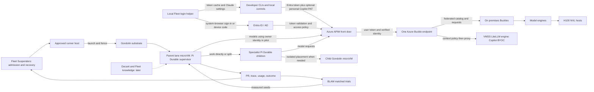

# Rollout plan — Azure Buckle, Fleet workers, and on premises models

## TODO index (2026-11-17)

- [x] P0 — PAT cycle LIVE on VMSS (issue→seat→PR, PRs #79–#112); BYOC URL-token lanes; Responses dialect f6ff9da live (gpt-6.1-terra 200); copilot-integration-id on both branches
- [x] P0 CLI verification — unmodified `claude` against the live lane URL (2.1.312, `wire ok`; receipt in P0.2c)
- [ ] P0 CLI verification — Copilot CLI against the lane URL; Entra/APIM leg remains part of P0.2
- [x] P0.2d owner-pilot login script — isolated package and 8 unit tests complete; receipt in P0.2d
- [ ] P0.2d live Entra GUI device-flow — BLOCKED on owner pasting Entra client ID (P0.2 APIM same blocker)
- [x] P1 — fleet-worker extraction (f8073fb; version matrix docs/worker-moved.md; rollback worker:e72086d)
- [x] P2.1–P2.3 executor axis — qemu-TCG/kvm guest (worker-gondolin image; guest kill/requeue/fresh-fence receipts; supervisor split cc1fb0e); same-conversation recovery remains P6
- [x] P2.4 — local Docker Desktop runner (7016770+4858518; PRs #92/#94 receipts)
- [ ] P2 krun executor — parked (aborts x86_64 in gondolin 0.14.0; alpine guest has no bun)
- [ ] P3 — H100 federation — parked (m04268)
- [x] P4 pilot receipts — 8-way concurrent (PRs #103–#110), parent/child split (PR #52), run-key revocation (PR #50), stale-lease refusal (d3584bd), docs/RECOVERY.md; P6 tracks stronger durability claims
- [x] P5 first slice — matched trials solo/concurrent/split run + docs/TRIALS.md (full BLAM deliberately not ported — owner directive)
- [ ] ChatGPT review fixes (13 findings, 2026-11-17) — MINTED & MOSTLY LANDED: #1 catch-all auth and #2 Buckle SSE landed in code + live-path verified (anon→401 both engine and lane paths; SSE through lane 200 text/event-stream with real seat deltas). #13 litellm digest pinning landed as fleet-buckle PR #2 (1393027, law buckle.laws.images.ts; index digest sha256:bd089afd…). Worker-plane findings minted as klh/fleet-worker #28–#35: LANDED via squash merges #29→PR#37, #30→PR#36, #32→PR#42(+ported supervisor pagination hunk), #33→PR#39, #34→PR#38; fleet-worker main ebb6109 (165 tests) rolled to VMSS. OPEN: #28 auth needs wiring (PR#40 bounced — module good, never wired; RE-MINTED as ready task 2026-11-17 triage), #31 red gate settles-done (CLOSED done 2026-11-17: landed twice, tasks 75/92 done), #35 Last-Event-ID resume (RE-MINTED task 93; root cause = seat stream cuts — new issue #136 for the bounded-reconnect fix). Triage 2026-11-17 evening: closed as DONE with store evidence — #5 (Responses dialect live in buckle f6ff9da), #68, #75 (POST /close), #76 (POST /retry-failed), #78 (terminal 409 guard in 5bdd486), #91, #97, #103; re-minted failed-but-real #95/#96 as ready tasks. Buckle-side #3 GUI parked design-first (see GUI row); #12 sidecar dispositioned docs/target-architecture.md §5 row 11.
- [x] P6 first slices — MINTED (klh/fleet-worker #22/#23/#24): ALL LANDED — PR #25 (GET /watch typed SSE) / #26 (exactly-once effects) / #27 (durable journal resume) + wire-up 3e7da45. Follow-up slices: task_graph+conversation event kinds LANDED (PR #38); Last-Event-ID resume = open issue #35; watch auth folded into #28; GUI client parked design-first. Owner target directive + journal-proof gate recorded at the P6 section head; new mints #43 (probe must exercise BYOC lane leg), #44 (journal persistence + replay proof gate), #45 (job-parent-in-guest contract) — PRs #46/#47/#48 RAISED BY LANES AND MERGED (all closed 2026-11-17; 0 open PRs at triage). P6 gate evidence round re-minted as klh/fleet-worker #134 (kill/recreate receipts).
- [x] Backlog saturation mint 2026-11-17 evening — queue had drained (149 tasks: 117 done/30 failed/2 cancelled; lanes exited "queue drained"). Minted: historical supervisor-mind wave #129–#132 (now superseded by P6 correction: Pi root agent owns workflow; do not implement the former alarm/shatter/mind design), P6 gate receipts #134, Copilot CLI smoke #135, seat-stream reconnect #136; re-minted #95/#96/#28/#35 as ready tasks. Parked rows (Entra client ID, krun, P3, GUI, zram/settings-pin/Mac-upstream, t-shirt) intentionally NOT minted.
- [ ] GUI — Pi runner workbench redesign is active in fleet-buckle-gui; its plan.md refactor section supersedes the former read-only one-page brief and issue #3 design gate. Implement through the separate GUI repo after typed Pi read/command contracts are available.
- [ ] zram on VMSS (m02251) · tracked-settings pin (m02917) · azure-buckle-as-Mac-upstream (m00957)
- [ ] t-shirt store templatization — owner-queued, awaiting brief
- [ ] P6 — one Pi Durable runner lifecycle, native wake/task graph, and a thin operator UI; ordered plan at the end of this file

Implementation status: the architecture is agreed; dispatch begins with
the current-chain characterization in
[`implementation-contract.md`](implementation-contract.md). That contract
defines repository ownership, bounded lane briefs, unresolved credential
bindings, and the boundary guard required before multiple feature lanes.
This roadmap does not authorize one lane to build all of P0–P5.
`docs/target-architecture.md` is superseded design history.

## Anchored owner directives (2026-11-16 — binding until superseded here)

1. **Workers self-pick their model via `.prefer` semantics.** No single
   hard-pinned lane model. A startup file (hardcoded for now) typically
   lists `hub=` and `prefer=`. Parsing follows the fleet `.prefer`
   vocabulary: `must=` / `prefer=` / `can=` accept comma-separated models
   tried **in order of listing**; `hub=` / `hub-url=` accept
   comma-separated buckle endpoints, first working wins. The worker
   probes buckle's catalog, takes the first model that round-trips a
   representative ask, and works there.
   - `prefer=a,b` — ordered soft list; if NONE are available/working,
     fall back to a baked-in list of DEFAULTS and try those in order.
   - `must=a,b` — ordered hard list; if none work, the worker **errors
     out** (refuses to run on a wrong model).
   - `tag=` / `color=` — identification keys (label the worker in logs/
     dashboards); no routing effect.
2. **Worker auth topology**: pilot workers act as the owner and call
   Buckle through the authenticated deployment boundary. The operator's
   bootstrap supplies admission credentials; Buckle is not a new login
   or credential-issuing service. Worker pilot engine-held credentials
   are a separate mode from human BYOC, as specified below. Endpoint
   fallback uses only configured, authorized Buckle endpoints preserving
   the same identity/grant contract; never direct-provider bypass.
3. **PAT custody has two explicit modes.** Humans supply their own PAT
   by URL or Bearer; Buckle relays it transiently. The isolated owner-worker
   pilot may instead provision the owner's PAT only at its LiteLLM engine;
   Buckle gets an engine key, never a mounted worker PAT. A human BYOC
   request must never fall back to that owner-worker credential.
4. **Keep LiteLLM current through qualified upgrades.** Test the latest
   candidate against catalog, both auth modes, Messages, tools and SSE;
   then deploy that exact image digest and retain the previous digest.
   Never deploy a moving `latest` tag or auto-upgrade outside this check.
   LiteLLM owns provider parameter translation; record concrete failures.
   Enforcement gap: `deploy/compose.azure.yaml` still uses
   `ghcr.io/berriai/litellm:latest` (review #13). Add a check-laws rule
   rejecting floating image references in deploy Compose files and pin
   the qualified image by immutable `@sha256:` digest in the same change.
   The reported live version `1.103.0` is not itself a digest; resolve
   and record the running image's actual digest before pinning it.
5. **Later, not now**: launching workers from GUI / CLI / MCP-skill, and a
   job-placement ledger in Suspenders remembering what runs where.
   Hardcoded startup file until then; Buckle's request/usage ledger is
   separate and does not acquire scheduling or job-state responsibilities.
6. **No max_tokens or limits on worker asks (for now)** — proven root
   cause 2026-11-16: the copilot seat 422s when input + default
   completion allowance exceeds the SKU's budget (max_tokens=256 → 200,
   1024+ → 422 on the same ask). Resolution is model PICKING, not
   capping: the .prefer probe uses the heaviest ask shape and skips any
   model that cannot serve it unlimited. `.prefer` may still carry
   operational knobs — `max_tokens`, `max_loops`, and similar — where
   ABSENCE or 0 means no limits (the default stays unlimited).
7. **8-lane durable crash-recovery demo (goal state)**: fleet-worker's
   deployment launcher starts eight scoped Pi Durable workers on Azure;
   Suspenders owns their admission and recovery as that integration lands.
   Buckle serves their model traffic. Each lane has its own worktree,
   write scope, stable run ID and journal. Publishing to ACR is preparation;
   an explicit deployment/restart action is the failure event. The
   [recovery procedure](#eight-worker-recovery-procedure) below defines
   the P1.5→P3 demo and does not make Buckle a worker launcher.
8. **Prime the 8 workers from the pi-durable template examples to work
   on fleet itself** (fleet-buckle + fleet-worker once extracted): needs
   one new example.md variant for working on the fleet repos — the
   repoagent example pattern pointed at our own repos.
   Pi's 2026-11-17 session reports a VMSS supervisor repointed to
   `klh/fleet-worker` with `MAX_LANES=8` after wiping clones. This is a
   reported pilot state, not a verified recovery receipt: a clean boot
   cannot prove continuity of the original journals or workspaces.
   Fleet-worker issue #1 starts the ownership inventory; the example.md
   variant with children remains queued until flat-task operation works.

Architecture (owner ruling, 2026-11-16; Azure VMSS is the live target):

- **fleet-buckle** = the identity-aware MITM around LiteLLM. It presents
  one Azure URL, fetches provider/peer model catalogs, federates to the
  correct Buckle + LiteLLM engine, tracks the authenticated user and
  request, and injects policy-bearing context where configured. It must
  preserve LiteLLM's supported API and provider capabilities rather than
  duplicate LiteLLM routing, model lists, limits, or per-user controls.
  Clients/workers choose the requested model; LiteLLM owns deployment
  resolution, aliases and provider routing. Worker `.prefer` behavior
  remains client policy and is being implemented in a separate lane.
- **Human identity and Copilot:** APIM validates the user's Entra ID/AD
  token and endpoint access. The user token and verified stable identity
  continue to Buckle; Buckle maps the user for federation, context policy,
  and observability. Prefer LiteLLM's native user/team mapping and controls
  when the deployed version and license support them; otherwise implement
  only the missing binding at Buckle. MS Copilot also needs each user's
  GitHub PAT. The client supplies it per request in a URL lane or Bearer
  header, as the client requires;
  it passes through to LiteLLM/Copilot without becoming shared server
  config. Prove isolation between users and deny direct APIM bypass.
  For the first rollout, trust the authenticated caller's supplied PAT;
  do not add an Entra-to-GitHub account binding requirement.
- **Pilot worker identity:** workers use the owner's authenticated identity
  for now, with distinct Fleet run IDs for attribution. BYOC workers relay
  an owner-supplied PAT; the explicitly isolated engine-held pilot keeps
  that PAT only at its dedicated LiteLLM engine. Record the mode in each
  receipt; never switch modes on auth failure. Dedicated identities are later;
  do not claim service identity or independent seat entitlement yet.

- **Future worker credential custody (deferred):** move owner/worker provider
  credentials to a governed Buckle/LiteLLM secret-backed route. A worker
  authenticates with a short-lived, scoped lane identity and requests an
  entitled model or capability; Buckle checks job, principal, epoch and
  grants, while LiteLLM resolves the upstream secret and applies model,
  MCP and agent access controls. LiteLLM virtual keys govern caller access;
  database-managed model credentials are encrypted with LITELLM_SALT_KEY
  for shared deployments. Its external secret-manager integration requires
  an Enterprise license; otherwise use a hardened engine-side secret
  source. Test whether the chosen custody path supports distinct personal
  Copilot PATs without exposing them to other owners before adopting it.
  Do not build a provider-key vault in Worker.
  Raw upstream PATs/keys must not enter the guest image, journal, trace,
  work brief or URL. Add opt-in enrollment, rotation, revocation, owner
  attribution and cross-user isolation tests before migrating any human
  BYOC path. Until then, keep the recorded BYOC and isolated engine-held
  modes distinct; do not silently switch on auth failure.
- **fleet-worker** = Pi Durable parent/child runtime, a versioned agent-guest
  image, capability templates, persistent journals, and whole-cycle e2e. A parent may
  work alone or split into scoped child sessions and integrate their patches.
- **Runner target** = one Gondolin microVM per autonomous worker lane,
  with a Pi Durable parent that supervises its own task graph, can work
  itself, and can create scoped Pi Durable specialist children. A child
  may share the parent guest or get its own fenced microVM when isolation,
  capacity or lifetime warrants it. The host
  supervisor admits, fences, starts and observes the guest. The journal
  must survive guest replacement outside its disposable root disk;
  model access goes through Buckle/LiteLLM under scoped host policy.
  Current bounded tool guests are an intermediate proof, not the target.
  Inference GPUs and microVM-capable runner hosts can be separate machines.
- **Fleet Suspenders** = admission, capacity, fencing, monitoring, recovery,
  and operator outcomes. Minimal integration is needed for the runner pilot;
  richer multi-host control follows. Developer CLI sessions have a separate
  local control face and are not automatically autonomous jobs.
- **BLAM** = isolated matched trials and evidence-backed seed promotion.
  Decant/Fleet knowledge is later. Absurd is only a possible future
  cross-host delivery experiment, not an extra work ledger in this rollout.

Current evidence: the plan records `/dev/kvm` on the 2-vCPU/7-GB VMSS;
recheck usable virtualization at deployment. `fleet-buckle` already has
Docker federation and Azure/BYOC tests plus an OCI worker prototype whose
Docker microworkers perform file checks. An engine-held-seat generator
experiment emitted 42 Copilot legs; that does not prove the VMSS serves
them or verify personal BYOC. Use it only for the isolated worker mode
after a live receipt; it is not the human credential configuration. The current
worker is not yet a microVM-hosted Pi supervisor. Label Docker Desktop,
emulated QEMU, VMSS, and real Xeon evidence separately. This plan records
intended work, not deployment state.

Known Phase 0 gaps: `test/e2e/buckle.e2e.azure.spec.ts` demonstrates OIDC
on the GUI `/api` seam while the model wire remains separately reachable.
`deploy/worker/worker.model.ts` sends a hardcoded body model to prove an
old lane pin. Neither is the desired Entra-bound, catalog-selected flow.

---

## P0 — personal-Copilot-PAT cycle on the live Azure VMSS — FIRST

Prove the human MITM + LiteLLM + Entra + client-supplied PAT chain and
one explicitly recorded worker auth mode before extraction. Engine-held
worker credentials never substitute for the human BYOC proof. P0's
owner-pilot exit is separate from its later org-readiness gate.
Select a model from the live catalog for each test;
do not add a Buckle model pin or a hardcoded catalog row.

- **P0.1** deploy the intended BYOC LiteLLM pass-through on the VMSS.
  Buckle fetches the live Copilot catalog with the caller's PAT, injects
  policy-bearing context where configured, then forwards the request
  through LiteLLM to Copilot. Keep LiteLLM responsible for model/provider
  capabilities; prove the relevant API faces and streaming survive both
  proxy hops. Keep `ENGINE_HELD_SEATS` confined to a separate worker
  engine configuration; never enable it as the human BYOC fallback.
- **P0.1a** remove the worker's hardcoded `glm-4.5` body-model and the
  lane-pin proof as rollout assumptions. Consume the separate `.prefer`
  lane's changes and receipt; do not duplicate or alter its semantics in
  this rollout lane. Verify the resulting client/worker selects from
  the live authorized catalog; LiteLLM resolves the deployment and any
  model alias, balancing, or fallback. Buckle preserves that request and
  records the served result without maintaining a second model router.
- **P0.2** put APIM in front of the VMSS Buckle model API. APIM validates
  the Entra token, tenant, audience, and allowed user/group before
  forwarding the request. The validated user identity and original user
  token continue to Buckle; block direct access that bypasses APIM.
  Buckle maps the stable user for its own federation, context, and logs.
  First test whether this token can reach LiteLLM's native JWT user/team
  mapping in the deployed version and license. [LiteLLM documents JWT
  user/team mapping as Enterprise](https://docs.litellm.ai/docs/proxy/jwt_user_team_auth);
  the repo's `compose.real.yaml` uses v1.103.0,
  while the VMSS image must be inspected. If unavailable, specify and test
  a narrow Buckle-to-LiteLLM user binding, or mark those LiteLLM per-user
  controls unavailable in the pilot. Never silently map all developers
  to one engine user. Never trust a client-supplied identity header
  without the APIM boundary. This protects the **model wire**, not merely
  the GUI `/api` seam.
  A Bearer PAT and a LiteLLM JWT cannot occupy the same Authorization
  header; verify LiteLLM's actual per-user binding mechanism for this
  request shape rather than assuming JWT passthrough works.
- **P0.2a** carry two distinct credentials on Copilot calls: Entra
  user token for APIM and Buckle admission (and LiteLLM user mapping
  where supported) and that user's GitHub PAT for the Copilot upstream.
  Keep the PAT in user-side CLI/worker
  configuration; Buckle and LiteLLM relay it only for the request.
  Prove the current client and LiteLLM version can carry both without
  one overwriting the other. Human BYOC stores no shared PAT in VMSS env,
  engine config, image or database. The isolated engine-held worker pilot
  mounts its owner PAT only as an engine secret, never into Buckle or an
  image. Both worker modes act under the owner's identity.
  Support both `Authorization: Bearer <PAT>` and the existing
  `/w/<lane>/<PAT>/v1` path where a client requires it. On Bearer-PAT
  calls, carry the Entra token in a separate named header validated by
  APIM; APIM must remove caller-supplied identity assertions before
  stamping the verified identity for Buckle. Never interpret the PAT as
  an Entra token or let a path PAT take precedence over a different
  Bearer PAT silently. Test the actual client behavior for each carrier.
- **P0.2b** verify the BYOC catalog path: with the owner's PAT, the
  owner and pilot worker can fetch the live Copilot catalog; with no
  PAT, the cold Copilot catalog is honestly unavailable. The current
  `src/catalog/buckle.catalog.fetch.ts` implements the cold behavior.
  Test per-user authorization even if model rows are cached seat-wide.
  A second user's PAT must never be reused or exposed by catalog cache,
  logs, traces, error bodies, or the current `/w/<lane>/<token>` URL
  carrier. If the carrier cannot be made safe, change it before rollout.

  **STATUS 2026-11-17**: catalog cache isolation landed — BYOC rows
  cache under the PSEUDONYMOUS user id (never the credential; one
  user's rows never served to another — unit-proven with per-bearer
  stub seats), and a tokenless caller gets honest emptiness (the
  warm-under-someone's-PAT branch is gone). Classic providers keep
  the seat-wide cache. Docker azure spec already proves the tokenless
  404-with-contract-hint and two-dev/two-principal isolation through
  the engine leg. Remaining live axis (two REAL seats' entitlements
  differing) is owner-pilot observation, blocked on the Entra client
  ID with the rest of P0.2.

- **P0.2c** prove unmodified Claude Code can use Buckle as its gateway:
  put its gateway variables in the user's Claude settings JSON. For
  Bearer-PAT mode, `ANTHROPIC_BASE_URL` points at the APIM Buckle
  `/w/<lane>` root, `ANTHROPIC_AUTH_TOKEN` carries the personal PAT,
  and `ANTHROPIC_CUSTOM_HEADERS` carries the separate Entra token.
  For URL-PAT mode, the base URL ends in `/w/<lane>/<PAT>` and
  `ANTHROPIC_AUTH_TOKEN` carries the Entra token in the normal
  Authorization header. Both are client settings, never repo settings.
  Exercise `/v1/messages` with tools, SSE, and a full tool round trip;
  forward Anthropic version/beta headers and streamed events in order
  without buffering. Enable gateway model discovery and verify
  `/v1/models` contains only the authenticated user's entitled rows.
  For the owner pilot, explicit script rerun on Entra expiry is enough;
  test automatic refresh before broad adoption. If the starting model ID is absent,
  select an entitled discovered model in the client or configure a
  LiteLLM alias; do not pin the lane or hardcode a Buckle model row.
  A local Fleet harness/skill/MCP may later acquire and refresh Entra
  tokens and set CLI configuration. A static settings token expires;
  prove a renewal path before broad adoption (for example a tested
  credential helper for URL-PAT mode). The Azure wire contract must
  work without a custom Claude Code binary. [Claude Code's
  gateway configuration](https://code.claude.com/docs/en/llm-gateway-connect)
  documents these variables. LiteLLM owns the Anthropic Messages to
  provider/model translation, including GLM and other model families;
  Buckle preserves that engine capability through federation and context
  injection. The live CLI test verifies our deployed chain, credentials,
  tools, and streaming. Anthropic's vendor support policy is not an
  architecture gate for this rollout.
  RECEIPT (2026-11-17, azure VMSS, buckle 0fa5f67): unmodified Claude
  Code 2.1.312 round-tripped the live chain — claude CLI → buckle
  `:4111/w/b3-gpt-consult/<PAT>` → engine byoc pass-through → MS
  Copilot seat (`claude-sonnet-5.5`); `-p 'Reply with exactly: wire
ok'` → exit 0, output `wire ok`. Curl leg: `/v1/messages` with tools
  - stream → 200 SSE with a streamed `tool_use` block (forced
    `tool_choice` is rejected by the seat itself — not a wire defect).
    `/v1/models` returns the entitled seat catalog. Live lessons: (1) a
    lane's pinned model overrides the request body model — pin a
    messages-capable model (a Responses-only pin such as `gpt-6.1-terra`
    yields Copilot's `no model endpoints available given user
constraints` on `/v1/messages`); (2) headless CLI runs need a fresh
    `CLAUDE_CONFIG_DIR` with `{"hasCompletedOnboarding":true}` — the
    default config dir's keychain/OAuth touch hangs a no-TTY `-p` run
    before any HTTP. The Entra/`ANTHROPIC_CUSTOM_HEADERS` leg rides the
    APIM front door (P0.2, client ID still awaited).
- **P0.2d pilot shortcut (owner approved)** use a small standalone
  Node/Bun script under `test/manual/entra-login/` while the final auth
  tooling is decided. **STATUS: package written (`@fleet/buckle-entra-login`
  0.1.0, 8 unit tests green, own tsconfig/deps, excluded from the root
  project; live owner pilot pending the Entra client ID).** Usage:
  `bun test/manual/entra-login/src/entra-login.main.ts <config.json> [claude
args…]` — config is a 0600 machine file shaped like the committed
  `entra-login.example.json` (placeholders only); the PAT lives in its own
  0600 file. Give it a registered public-client app ID, tenant,
  API scope, gateway URL and a local PAT file path through runtime config.
  Use MSAL's browser authorization-code flow to obtain an API access
  token after tenant-required MFA; do not use a Graph token or ID token.
  Write a private temporary Claude settings file, preflight APIM, then
  launch the CLI. Support the URL-PAT and Bearer-PAT configurations above.
  On expiry, exit clearly and rerun the script; automatic renewal, a
  permanent token cache, skill/MCP packaging and a new client repository
  are not pilot prerequisites. Keep its dependencies in its own package;
  no Buckle runtime dependency or production auth subsystem is added.
  The script does not replace APIM validation or the per-request identity
  contract. Record the live owner pilot separately from org readiness.
- **ORG.1 (deferred; not a P0 exit requirement)** ship the permanent
  login/bootstrap command before general org access. The temporary script
  is sufficient for the owner pilot and extraction. The command checks the Entra token cache silently,
  opens the system browser for interactive sign-in when required, and
  offers device code as a fallback. It requests the APIM API audience,
  stores the token in an OS-protected user cache, and preflights a safe
  authenticated Buckle catalog request before launching Claude Code.
  On APIM 401 during use, reacquire once and recheck access;
  never ask an LLM to repair login. A 403 or valid-token group denial
  remains an access error; do not loop through browser sign-in. In
  URL-PAT mode, test Claude Code's
  `apiKeyHelper` as the renewable Entra credential (it emits the token
  only and sends it in both Authorization and `x-api-key`; Buckle must
  ignore that `x-api-key` as a Copilot PAT). In Bearer-PAT mode, prove a
  separate dynamic Entra-header injector or require an explicit session
  restart; a static JSON header is not a renewal strategy. Use a small
  local CLI first; a skill or MCP can call it later. [MSAL cache and
  interactive guidance](https://learn.microsoft.com/en-us/entra/msal/msal-acquire-cache-tokens)
  and [Claude Code's credential helper](https://code.claude.com/docs/en/llm-gateway-connect)
  are the implementation references.
- **P0.3** run the current Pi Durable worker under the owner's verified
  identity in the declared BYOC or isolated engine-held mode. Keep a
  separate Fleet run ID; neither mode is a separate Copilot seat or
  independent worker identity. Provision admission credentials through
  the operator bootstrap; do not build a Buckle credential broker.
  From the live catalog choose an available model, prove direct LiteLLM
  chat and Buckle chat/stream with the actual served model, then run the
  full repoagent cycle on issue #6 if still suitable (real diff, PR,
  branch preview). Restart mid-cycle and record recovery and failures.

**Owner-pilot exit (unblocks P1)**: APIM validates the owner and passes
the verified identity and original Entra token to Buckle. Native LiteLLM user mapping is proven
where available; otherwise record the pilot limitation and block broad
multi-user rollout until per-user binding is tested. Both URL-PAT and
Bearer-PAT paths preserve the same user attribution;
the human client's owner-provided PAT reaches Copilot through Buckle and
LiteLLM without a server-held shared PAT on the human route. The worker
cycle uses the separately recorded auth mode. Catalog, chat, stream, context injection,
usage attribution, and denial without a valid user/PAT are observed live.
Test missing, expired and invalid Entra tokens; missing and invalid
BYOC PATs; conflicting URL and Bearer PATs; and refusal to use the
owner-worker engine credential on a failed human request. Redact URL
credentials from APIM, Buckle,
LiteLLM, reverse-proxy, and trace records.
Cold-start login must open the browser before any model call. The owner
pilot may recover an expired token by rerunning the temporary script;
automatic renewal is an org-readiness gate. A denied principal receives
a clear error without a sign-in loop.
The worker cycle produces a real PR and resumes the same submission after
restart. Record commands, source SHA, image digests, VMSS instance,
selected and served model, declared auth mode, result links and timestamps.
Relevant Docker Desktop tests pass on the same source. Synthetic two-user
credential-isolation tests are required; two live developer accounts and
the permanent login tooling are not prerequisites for the owner pilot.

**Org-readiness exit (before broad access; does not block P1/P2)**:
complete ORG.1 and prove two real Entra users with their own PATs have
isolated catalogs, policy context, logs and usage through APIM and the
selected LiteLLM user binding. Test cross-user/spoofed identity, revocation
and token renewal. Record known pilot gaps until those tests pass.

**Checkpoint**: this exact system is what fleet-worker extracts.

## P1 — fleet-worker repo (extraction; product = code + images + e2e)

- **P1.1** skeleton mirroring fleet-buckle's laws (AGENTS.md adapted:
  TYPE LAW, NO-TRY-CATCH, 400-line/60-fn/25-stmt, qlty blocking, knip,
  no-slop tests, edit law, exactOptionalPropertyTypes, TS4111; package
  scripts; tsconfig.base; .githooks/pre-commit; dotfiles; knip.jsonc).
- **P1.2** move: `deploy/worker/worker.*.ts` (11 files, 866 lines) →
  `src/` (names preserved, minimal churn); the 38 pi-durable `examples/`
  → `examples/` (durable-API reference, ships with the product);
  `deploy/worker/Dockerfile` → root `Dockerfile`; `test/kit/stub` →
  `test/kit/stub`; `test/e2e/buckle.e2e.agent.spec.ts` →
  `test/e2e/worker.cycle.spec.ts` composing the PUBLISHED fleet-buckle
  image (registry-pin env, version matrix).
- **P1.3** pin the Pi Durable runtime to the exact version currently
  used by the worker (`1.5.0`) and carry its copied examples as a
  versioned reference. Prove the image build works under the intended
  offline-LAN dependency policy; document the pin in AGENTS.md.
- **P1.3a** inventory the complete extraction closure, including
  `src/agents/`, any seed build, supervisor docs, root runtime dependencies
  and exports. Give each file one home: move worker responsibilities to
  fleet-worker, keep only gateway contracts in Buckle, or remove proven
  unused code in a separate bounded cleanup. The historical lift table
  does not authorize copying more monorepo code. Confirm inventory and
  actual installed versions; file counts in this roadmap are not proof.
- **P1.4** gates port: tools/src/{check-laws,laws.scan,laws.shapes},
  playwright config, unit tests, CI = tsc + unit + e2e + qlty + knip.
- **P1.5** publish/pin the immutable Buckle image needed by the new
  standalone worker e2e before cutting the test over. Replace the VMSS
  worker with a pinned `fleet-worker` image, prove journal compatibility
  and the real cycle, and retain a rollback image. Only then remove
  `deploy/worker/` and its tsc target from Buckle; keep a pointer doc
  and cross-repo version matrix. Both repos' gates must remain green.

**AC**: fleet-worker standalone green (tsc, unit, e2e cycle vs published
buckle image, laws, knip); fleet-buckle green without worker code; both
landing commits cross-reference shas; image builds:
`docker build -t ghcr.io/klh/fleet-worker:<sha> .`

**Checkpoint**: `fleet-worker` builds an image that passes its own e2e.

### Eight-worker recovery procedure

The launcher and this procedure belong to fleet-worker's deployment
tooling; Suspenders supplies admission/recovery integration as it lands.
Buckle has no worker-spawn API or deployment supervisor for this demo.

1. Start eight scoped workers on the pinned current image. Record each
   run ID, assigned work, worktree, journal/checkpoint and writer epoch.
   Place each journal on an explicitly identified persistent volume,
   outside its replaceable container; verify it is remounted on restart.
2. Publish the replacement image to ACR and record its digest. Publishing
   alone is not the crash. While work is active, explicitly stop/kill all
   eight worker containers using the deployment tool. Record that exact
   command, the affected VMSS instance and the interruption timestamps.
   Buckle/LiteLLM may stay running; record separately if they also restart.
3. Deploy the new digest and start the workers against their original
   journals and run IDs. Acquire new writer epochs and refuse old writers.
   Reconcile GitHub effects before retrying so comments, PRs and commits
   are not duplicated. Resume the same work rather than create new jobs.
4. Prove all eight resume from recorded checkpoints and produce reviewed
   outcomes. Record old/new image digests, recovery times, reconciliation
   evidence and rollback. A volume surviving container replacement is
   not proof of VMSS reimage/host-loss recovery; test those separately
   with storage that survives that failure before claiming host recovery.

**RECEIPT — live on the Azure VMSS, 2026-11-17 (fleet-worker
`2697dd5`, buckle `b5d5726`)**. Rig repo `klh/fleet-recovery-rig`, 16
GitHub-issue tasks, supervisor container with N clone lanes (not eight
separate containers; a documented deviation — one supervisor owns the
lane lifecycle, each clone is its own process/journal). Wave 1: 8
issues → 8 clones → 8/8 tasks done first-attempt (~30s/task), 8 PRs
merged. Wave 2: 8 more issues; at 01:25:07Z, mid-work,
`sudo docker compose stop supervisor` (buckle/engine/gui/health stayed
up); clones died with PID 1; tasks 9-15 settled in the final seconds
(PR #31 closed the last one), task 16 stranded on dead clone-8. The
claim lease (`LEASE_MS` = 15 min, hardcoded) expired at 01:39:47Z;
the boot sweep flipped task 16 to requeued, the spawner respawned a
fresh clone, which reclaimed it at `attempts: 2` (~01:40:25Z) and
settled it ~90s later as PR #32 — merged. No writer epochs exist;
recovery is task-level at-least-once: per-lane journals
(`/state/<lane>.sqlite`) and workspaces (`/workspace/<lane>`) ride
persistent volumes. PR-match reconciliation scanned open PRs for
"Closes #N" and avoided a duplicate PR in this run; it does not cover
closed/merged PRs or prove idempotency of other GitHub effects.
All 17 PRs merged, branches deleted, 16/16 tasks done. Old/new image
digests were identical (`2697dd5`) — the kill leg proves lease/requeue
redelivery, not cross-image journal compatibility; that stays
untested until the next worker image rotation replays this procedure.
Host-loss reimage recovery remains untested (single VM).

## P2 — real microVM tool execution on the existing VMSS

- **P2.1** pin Gondolin and its selected backend. Verify usable KVM on
  the VMSS rather than assuming `/dev/kvm` alone proves it. If that
  backend cannot boot there, record the result and select a supported
  QEMU/libkrun mode explicitly. Firecracker is a later Linux/KVM option.

  **RECEIPT — live on the Azure VMSS, 2026-11-17**. Pinned
  `@earendil-works/gondolin@0.14.0`, backend `--vmm qemu` (krun aborts
  on x86_64 in 0.14.0 — known issue, fix unreleased). Disposable
  container `oven/bun:1-slim` + `qemu-system-x86 qemu-utils` on the
  VMSS, guest `alpine-base:0.5.0` (builtin content-addressed
  registry): `gondolin exec -- uname -a` → `Linux (none) 6.18.63-0-virt
… x86_64`. KVM proven by A/B, not assumed: WITH `--device /dev/kvm`
  cold 6.7s / warm 2.9s; WITHOUT (TCG) cold 11.3s / warm 7.0s. KVM
  access works from a plain container as root with `--device /dev/kvm`
  (buckleadmin itself lacks the kvm group; the device mapping
  suffices). First slice of P2.2 proven; the executor seam is next.

- **P2.2 (intermediate, already implemented)** keep the Pi Durable parent
  and journal in the OCI worker on the host. Add a Gondolin executor for
  bounded tool guests, with
  workspace leases, resource limits, default-denied network, and scoped
  credentials. A tool-guest proof is not whole-worker microVM packaging.

  **RECEIPT — axis landed live, 2026-11-17 (fleet-worker `f4b4622`,
  deployed to the VMSS as `worker:f4b4622`, all lanes green)**. The
  executor seam (`src/worker.exec.ts`) now has two backs behind one
  knob: `gondolinRun()` boots a pinned qemu VM (`alpine-base:0.5.0`,
  `createHttpHooks({allowedHosts: []})` = default-deny network,
  `vm.exec` argv form, `vm.close()` in finally = the workspace lease),
  and `checkFile` routes by `env.executor` (`WORKER_EXECUTOR`). The
  gondolin leg fails LOUD on code files — the pinned guest carries no
  python/node toolchain (P2.3 continuation: toolchain guest image) —
  rather than silently skipping the check or silently falling back to
  docker; either would undo the isolation the knob promises. Docker
  remains the default and the rollback. Six mock-module unit tests
  cover boot pinning, nonzero-exit throw with close still called,
  close-exactly-once, the loud refusal, and md no-ops on both backs;
  `tools/src/worker.smoke-gondolin.ts` is the live host proof entry.
  Same landing cleared the env-boundary law debt (sanctioned second
  loader `src/supervisor.env.ts`; lane spawns never spread
  `...process.env`; zod parses replace hand casts on sqlite/GitHub
  wire rows). Remaining to AC: a toolchain-bearing guest image so a
  real tool step executes inside the VM during the full cycle, the
  kill-the-guest fence/replace proof, and scoped-credential injection
  (secrets API is wired but unused by syntax-only checks).

- **P2.3** add a `WORKER_EXECUTOR=docker|gondolin` axis to the same
  whole-cycle test. The Gondolin adapter uses `VM.exec` and HTTP hooks;
  allow only the operation's named external/internal hosts and inject
  each credential for its matching host. The current `checkFile` seam
  runs syntax checks only; passing it does not prove GitHub/model calls
  execute inside the VM. Retain Docker as baseline and rollback.
  **STATUS 2026-11-17**: the axis knob and adapter exist (see P2.2
  whole-cycle gondolin test is PROVEN (receipt below); per-operation
  allowlists remain open.

  **P2.3 whole-cycle receipt (2026-11-17, fleet-worker 8bfcb3d):** the
  toolchain guest landed. worker-check:0.1.0 (gondolin buildId
  e2383717, x86_64, rootfsPackages python3+nodejs+uv+bash+curl) built
  from the default gondolin config; checkFile's gondolin branch now
  writes the file into the VM (vm.fs.writeFile) and runs python3 -m
  py_compile / node JSON.parse / node new Function INSIDE the guest
  (string-form exec — sh -lc resolves $PATH; argv form does no PATH
  lookup). Default-deny egress unchanged; VM closed on both paths.
  LIVE on the VMSS: in-container adapter proof (ALL-CHECKS-IN-VM-OK:
  .py + .json + .js under --device /dev/kvm), 15.6s cold / 15.2s per
  fresh-VM check (isolation price vs docker ~385ms — VM-per-task lease
  is the optimization), and a full QUEUE-PATH cycle green under the
  gondolin env (supervisor image worker-gondolin:8bfcb3d +
  WORKER_EXECUTOR=gondolin: recovery-rig issue #33 → task 17 →
  clone-1 session → PR #34, converter.py) — with the CORRECTION that
  this cycle did NOT exercise checkFile: the queue path runs agent
  sessions whose gate runs the repo test command (kind "none" on the
  test-less rig); checkFile (worker.flow.ts:219) is the SWEEP path's
  pre-PR fence only. Closing that gap is the next leg: the queue path
  needs a post-session changed-files check through the same
  checkFile seam (in-VM syntax fence on every PR the lanes raise).

  **Queue-path fence receipt (2026-11-17, fleet-worker 298d2aa):** the
  post-session fence is LIVE and PROVEN. worker.lane.ts now fences every
  changed file after the session settles and before the report: default
  branch via gh, `git diff --name-only origin/<default>...HEAD`, per-file
  checkFile (cap 25 files / 256KiB; missing/oversized → named `:skipped`,
  never silent), and the report note banks the evidence. First live fire
  (recovery-rig issue #35 → task 18 → lane-1, worker-gondolin:298d2aa):
  report #24 `settled=done pr=37 turns=14 note="session:settled;
fence:1[roman.py:py_compile]"` — the agent's roman.py was compiled by
  python3 inside the qemu toolchain guest BEFORE the PR banked green, PR
  #37 merged clean (+58/-0 single file). The fence also caught two real
  deployment gaps on the way (clones lacked XDG_CACHE_HOME → EACCES
  /tmp/.cache/gondolin; static lane services lacked the gondolin env and
  died on a socketless docker call — Bun fetch TypeError "typo in the
  url or port") — loud failures, requeue, fix, green: the design working
  as intended. Compose now carries WORKER_EXECUTOR+XDG_CACHE_HOME+/gcache
  on supervisor AND lane-1/lane-2 (uniform topology; lanes never touch
  the host docker socket). Remaining P2.3 legs: journal outcomes (the
  gate journal records only the repo test command — kind "none"
  pass-through on the test-less rig), VM-per-task lease (15s/check
  cold-boot price), scoped-credential injection via createHttpHooks
  secrets.

  **Kill-the-guest receipt (2026-11-17, fleet-worker 298d2aa):**
  guest death, loud failure, requeue and fresh-guest fence are proven
  live; same-conversation resume is not. Rig issue #44 (b64.py) → task 22
  → clone-5, with a host-side sniper loop (`pkill -f
"[q]emu-system-x86_64"` every 1.5s — the bracket class dodges the
  pkill self-match trap) killing the toolchain guest mid-fence.
  Reports #28/#29: `settled=error pr=null turns=0 note="Error: error
protocol_error: virtio bridge error: read ECONNRESET (qemu:
qemu-system-x86_64: terminating on signal 15)"` — the guest death is
  loud, names SIGTERM, banks no PR, and requeues. Attempt 1 had
  already raised PR #45. `turns=0` in the error reports is the lane's
  error-report default, not evidence of journal replay. Sniper stopped →
  attempt 3: report #30 `settled=done pr=45 turns=14 note=…fence:1
[b64.py:py_compile]` — fresh VM fenced the same diff green, PR #45
  merged. Two sniper bugs were caught by the rig itself on the way:
  racing the lane log misses a warm ~3s fence window, and a naive
  `pkill -f qemu…` loop kills its own shell on iteration 1. Also
  observed: fences currently run TCG (`-accel tcg` in the host ps
  catch, pid-level evidence) because worker-gondolin does not map
  /dev/kvm — ~15s/check vs ~3s with KVM (perf leg, not correctness).

  **KVM receipt (2026-11-17):** compose now maps `/dev/kvm` into
  supervisor + lane-1 + lane-2 with `group_add: ["993"]` (the host
  kvm gid; /dev/kvm is root:kvm 0660 and the containers run as uid
  1000 — numeric supplemental group, no image change). Post-recreate
  in-container probe: `VM.create` + `exec echo` in **3.0s** (boot+exec)
  vs ~15s under TCG, and the host ps catch shows `-accel kvm` ×14.
  Stack healthy after recreate; supervisor listening. /dev/kvm gid on
  this VMSS is 993 — bake it as a compose variable if the fleet grows
  beyond this box.

  **Fence VM-per-task lease receipt (2026-11-17, fleet-worker
  a4f6700):** `checkFiles(files)` boots ONE toolchain guest for the
  whole diff (lazily — an all-docs batch never boots) and keeps diff
  order; `checkFile` is single-file sugar over it. Live fire: rig
  issue #46 (JS port + node test suite) → task 23 → clone-1 →
  report #31 `settled=done pr=47 turns=9 note="session:settled;
fence:4[docs/TEST-SWEEP.md:unchecked;lib/b64.js:node-syntax;
package.json:node-parse;test/b64.test.js:node-syntax]"` — four
  files, three code checks, ONE boot under KVM (~3s, not 3×15s).
  PR #47 merged; the suite itself is 9 vector classes ×
  {encode,decode,round-trip} + a statelessness test — genuine tests,
  not presence stubs.

  **Gate-journal receipt (2026-11-17, same cycle):** the session gate
  leg is now proven on a test-carrying repo. The task-23 conversation
  journal (clone-1.sqlite, durable entries) banks
  `{"kind":"app.tests","cmd":"npm test","kind":"npm","passed":true,
"output":"> test\n> node --test\n\n✔ encodeB64: empty string …"}`
  — detect (package.json scripts.test) → in-container run (tool-seed
  carries node 26) → journaled GateOutcome, while earlier test-less
  sessions bank `kind:"none" … no tests detected — gate pass-through`
  rows in the same table: the contrast proves the detection, not a
  hardwired pass. This receipt tests only a passing suite. A failed
  gate is noted by harvest, but the current lane can still report
  `done` when a PR exists; P6 Step 4 closes that settlement gap.
  Scoped-credential injection via createHttpHooks secrets is
  DISPOSITIONED DEFERRED: fence guests are default-deny with no
  network need, and the plaintext childEnv() seam's consumer (guest
  egress) does not exist yet — revisit when a task legitimately needs
  guest network.

  P2.3 legs status: queue-path fence ✓, kill/requeue/replace ✓, KVM ✓,
  VM-per-task lease ✓, gate journal ✓, scoped credentials → deferred.
  **P2.3 executor axis closed.** Same-conversation recovery is P6.

- **P2.4** package the runner so Docker Desktop can exercise it locally,
  but require a separate live VMSS boot, tool, loss, and cleanup receipt.

  Local receipts (2026-11-17, Docker Desktop, fleet-worker 7016770,
  supervisor-compose.local.yaml + real overlay):
  - **BOOT**: hermetic world (zai-stub + gh-stub + buckle3 + supervisor)
    up clean; supervisor listening :7780.
  - **TOOL (real leg)**: issue #91 on icomdev/Vanilla-JavaScript-Calculator
    → imported → clone lane → session via the Azure seat (claude-sonnet-5.5
    BYOC lane) → branch agent/91 → **PR #92 merged-ready, 307 node --test
    pass**, docker fence `fence:4[README.md:unchecked;docs/KEYBOARD.md:
unchecked;script.js:node-syntax;test/keyboard.test.js:node-syntax]`,
    task settled=done (turns=9, 964 out-tok, 45.6 s).
  - **LOSS (banked 2026-11-17 06:12)**: `docker compose kill supervisor`
    mid-task (issue #93, branch agent/93 cut, session mid-flight) →
    lane processes died with the container; restart booted clean and the
    task rode the 15-min lease (supervisor.store.ts frees `assigned`
    tasks only at lease expiry). At expiry the sweep requeued it
    (attempts 1→2), a fresh clone claimed it, integrated the orphaned
    remote agent/93 branch without force-push, and settled **done**:
    **PR #94**, 359 node --test pass. Lane-loss with the supervisor
    ALIVE is the loud immediate requeue (ECONNRESET, proven on VMSS);
    supervisor-loss is lease-clock recovery — both receipted.
  - **CLEANUP**: `down -v` removes the world + volumes (receipt below).

  Root causes found on the local leg (all fixed in fleet-worker 7016770):
  Docker Desktop's socket is root:root 0660 (VMSS is root:docker 993) —
  `group_add: ["0"]` or the fence's unix-socket fetch dies as
  FailedToOpenSocket; the lane's gh CLI legs hardcoded real github (now
  REST via env.ghUrl + WORKER_GIT_URL); importOne's dupe guard ignored
  failed tasks (poison re-mint); handleReport double-read the body
  ("Body is disturbed or locked").

**AC (executor portion met):** a real VMSS microVM executes a tool step
during the full worker cycle. Guest kill reports failure, requeues, and
fences the diff in a replacement guest. Same Pi conversation resume is
still open under P6. Docker Desktop passes the executor contract where
supported; label its backend separately.

## P3 — federate the Azure endpoint with on premises H100 service

- **P3.1** inventory actual H100 hosts, operating systems, model
  servers, network paths, capacity, and separate microVM-capable hosts.
  Do not assume an inference GPU host can run the selected VM backend.
- **P3.2** deploy one on premises Buckle plus model engine, then
  configure it as a downstream peer of the Azure Buckle with explicit
  grants. Buckle uses live catalog provenance to choose the peer;
  LiteLLM at that peer owns model deployments, aliases, balancing, and
  fallback. Do not copy provider model lists into Buckle settings.
  Retain the VMSS Copilot route during commissioning.
- **P3.3** from a real developer CLI, prove one Azure URL lists an
  entitled H100 model, serves a chat and stream, and returns the actual
  served-by chain and usage. Test a denied principal, 429, and peer loss.
  Give on premises Pi sessions scoped access to the same model path.
  Verify that a Copilot PAT is never forwarded to the H100 peer or another
  provider when the CLI switches models in the same session.
- **P3.4** prove the actual Entra/network edge and human-to-principal
  mapping before broad developer access. Record human, CLI session,
  autonomous job, and model usage distinctly; no raw personal seat
  token belongs in a tool guest.
- **P3.5** maintain a compatibility matrix for the deployed LiteLLM
  version: chat, streaming, tools, responses and other endpoint families
  actually offered by each model engine. Buckle forwards supported
  calls and policy-bearing context without narrowing LiteLLM's feature
  surface; unsupported provider features fail honestly at the engine.

**AC**: a developer reaches an H100-served model through Azure Buckle;
a Pi job reaches its entitled route; both expose actual model/host usage.
Denied access and a lost peer fail visibly. Docker federation tests remain
green, but the on premises route must have its own live receipt.

## P4 — Fleet-controlled jobs and measured splitting

Fleet Suspenders admits jobs, applies capacity and fencing, launches a
versioned Pi Durable parent, and reports its journal, tool guests, model
usage, patches, reviews, and recovery. The parent chooses solo work or
children. Children receive separate Fleet run identities, budgets,
worktrees, and nonoverlapping write scopes; the parent integrates and
checks their patches. In the pilot, their Copilot requests still ride
the owner's identity, with PAT custody determined by the recorded BYOC
or isolated worker-engine mode. Dedicated worker identities and
Copilot entitlements require a later explicit migration and access test.
A no-split choice is a valid recorded outcome.

**Receipts**:

- **2026-11-17 (parent/children split, live)** — worktree-per-child
  landed (fleet-worker `570a1f0`: `worker.session.scopes.ts` registry,
  `sessionTaskHost.spawn` cuts `git worktree add -b <parent>-cN
.children/<branch>`, depth cap 1, bash/gh/gate resolve cwd per
  caller) and PROVED live on the VMSS rig: issue #51
  (`klh/fleet-recovery-rig`, "two INDEPENDENT additions") was claimed
  by the parent session, which did reverse.py solo, spawned a child
  (worktree branch `agent/51-c1`, commit `62798f2` "Add Unicode case
  helpers and table-driven CLI coverage for #51" authored in the
  child), MERGED the child's commit into mainline `agent/51`
  (`61863d8`), finished the docs itself, and settled done — PR #52,
  fence:6, 130 python tests passing, 21 turns, 202s. The child's
  branch, worktree dir (`.children/agent/51-c1`), and merged commit
  were all observed on disk post-run.

- **2026-11-17 (stale-lease refusal, d3584bd)** — `bankReport` used to
  settle any report unconditionally: a zombie lane whose lease had
  lapsed (task requeued and reclaimed) could still flip the task to
  done with its PR — stealing the settle from the live claimant.
  Guard added (report from a lane ≠ task owner is banked for the
  record, state untouched) + two units (zombie refusal; cancelled
  task refuses a late PR). Deployed to the VMSS supervisor. The
  revocation run already exercised the precondition live (clone-4's
  ghost claim was lease-swept and requeued); with the guard, its
  late report would have been refused instead of banking a second
  settle.

- **2026-11-17 (simultaneous jobs, 8-way)** — supervisor on the Azure
  VMSS (worker-gondolin:4858518, MAX_LANES=8, executor=gondolin,
  /dev/kvm) imported 8 freshly minted issues
  (#95–#102) from `icomdev/Vanilla-JavaScript-Calculator`, ramped one
  clone per 15s spawn tick to **7 simultaneous working lanes**, and
  settled **8/8 tasks done with zero failures and zero retries** in
  ~4 minutes of wall time (sessions 99–167s, 14–23 turns,
  2.7K–8.9K out-tokens each): PRs #103–#110. Fences ran on every
  settle (up to fence:9 on #110 incl. `tests/backspace.test.js:
node-syntax`); one transient `remote rejected … commit_refs_rules`
  push was retried and landed by the lane itself (#106). Sessions ride
  the Copilot seat lane via the principal-Bearer shape (WORKER_BYOC=
  false). Evidence: supervisor board (tasks 24–31 done),
  `[lane clone-N] task N: settled=done pr=…` log lines, PRs on the
  fork. The rig-era 8-worker recovery (23 tasks on
  klh/fleet-recovery-rig) predates this on the same plane.

- **2026-11-17 (run-key revocation + recovery, live)** — with the
  worker principal key pulled on the Azure buckle
  (`mv /state/keys/principal.worker@azure.key …key.revoked` — the
  registry reads key files per request, so the rename bites on the
  next ask), a claiming lane died loudly at its prefer probe
  (`no model passed the probe`, exit 1) and the task requeued. The
  owner PAT was proven untouched (GitHub API 200 with the PAT — it
  never rides buckle). Recovery: `POST /admin/keys {"principal":
"worker@azure"}` minted a NEW key (old value dead), written to
  /opt/buckle/secrets/buckle_key (0600), supervisor recreated. A
  ghost claim from the crash-loop window waited out the 15-min
  lease clock (sweepExpired requeue — supervisor-loss semantics),
  then a fresh clone ran a real session through the seat and settled
  **PR #50 on klh/fleet-recovery-rig** (task 34, issue #49,
  caesar.py + pytest, turns=17, fence:4). Bonus evidence: a
  mismatched issue body (calculator files named onto the python
  rig) was REFUSED twice by the seat — no fabricated work
  ("Blocked: … no calculator files … no existing MS/MR/MC
  implementation") — before the corrected issue went green in one
  attempt.

**AC**: run two simultaneous jobs and one parent/children job on the real
hosts. Independently kill a guest and a parent; prove journal resume,
stale-lease refusal, no duplicate unsafe GitHub effects, Fleet run-key
revocation (without revoking the owner's PAT),
and an operator recovery path. Normal developer chats remain separate
from autonomous Fleet claims despite sharing Buckle transport.

**PILOT CLOSED 2026-11-17** — simultaneous (8-way) and parent/children
(PR #52) receipts above; guest kill and supervisor-loss lease requeue
recovered at the task level. The receipts do not prove the same Pi
conversation resumed or that every unsafe GitHub effect is idempotent.
Stale-lease refusal was unit-proven and deployed; PR duplicate scan and
ownership guard are pilot defenses, not exactly-once proof. Run-key
revocation was live; operator
recipes written down in fleet-worker `docs/RECOVERY.md`. Developer
chats stay separate: autonomous claims only ever touched
`klh/fleet-recovery-rig` + the calculator fork, never an interactive
developer repo, while interactive sessions rode the same buckle front
on their own principals — zero cross-contamination events in every
receipt above.

## P5 — BLAM optimization; Decant and Fleet knowledge later

BLAM runs isolated matched trials during spare capacity. Hold task,
revision, model entitlement, aggregate budget, private judge, and merge
gate fixed while comparing solo work, concurrent tools, and parent/child
shapes. Measure accepted patches, wall time, tokens, contention,
recovery, and duplicate effects. Promote a versioned seed only with a
reproducible receipt and rollback digest. Benchmark runs must not write
to production developer repos.

**FIRST SLICE RECEIVED 2026-11-17** (fleet-worker `docs/TRIALS.md`):
three-arm matched trial on the real VMSS plane — seed `9011741` cloned
into three private trial repos, task set T1–T4 (two file pairs each)
minted identically per arm; solo (1 lane) vs concurrent (4 lanes) vs
split (1 lane + workers_task hint). All 12/12 settled done att=1,
fence:6, exactly one PR per task, zero duplicate effects. Concurrent
arm: 2.2× wall-clock (11.2 → 5 min), no per-session slowdown at 4
simultaneous seat sessions. Split arm: +27 % session wall, −18 %
mainline out-tokens. Trial repos are disposable (never production dev
repos). BLAM-as-a-package is deliberately NOT ported (owner directive:
the supervisor plane IS the trial harness); Decant/Fleet-knowledge
stages remain future work.

Once job identity, provenance, and access boundaries are stable, add
Decant/Fleet knowledge as scoped context. Record the knowledge version
used by each run. Absurd may then be compared as a Postgres-backed
cross-host delivery queue, but it must replace a named delivery duty
rather than create a second unreconciled Fleet work ledger.

---

Original rollout dependency order: **P0 owner-pilot exit → P1 → P2 → P3 → P4 → P5**.
The separate org-readiness exit gates broad access, not extraction or
the owner-worker demo. Inventory and
federation preparation may run alongside extraction, but every Azure or
on premises claim needs its own live exit receipt. P0's Entra/APIM pilot
remains open; P6's worker reliability work can proceed against the
existing pilot without treating that open identity gate as passed.

Every receipt pins source commit, Buckle/worker/engine image digests,
seed digest, model route, runner backend, host, and timestamp. Keep the
last known-good deployment for rollback. Use the existing Fleet work
graph and live coordination to assign implementation ownership; a DONE
item or this plan alone does not prove a service is deployed.

## P6 — one Pi Durable runner lifecycle and an operator UI (planned 2026-11-17)

P1–P5 record real pilot receipts. They do **not** prove that a retried
supervisor assignment resumes the same Pi Durable conversation, that an
unsafe external effect is reconciled exactly once, or that the current
"background" child survives its parent's tool call and process death.
P6 is production hardening for an already operating worker service.
Changes need compatibility, security, observability, rollback and
failure-injection evidence before rollout. Design references are the installed
`@earendil-works/pi-durable@1.5.2` API, upstream examples
[`22-subagent-background`](https://github.com/earendil-works/pi/blob/main/packages/durable/test/examples/22-subagent-background.ts),
[`32-tests-after-edits`](https://github.com/earendil-works/pi/blob/main/packages/durable/test/examples/32-tests-after-edits.ts),
[`34-submit-in-commit`](https://github.com/earendil-works/pi/blob/main/packages/durable/test/examples/34-submit-in-commit.ts),
[`40-tool-waits-for-webhook`](https://github.com/earendil-works/pi/blob/main/packages/durable/test/examples/40-tool-waits-for-webhook.ts),
and the [Cloudflare wake/activity example](https://github.com/earendil-works/pi-durable-cloudflare).
Upstream main now documents signal-driven parked tools and `onYield`
hook tasks that the installed 1.5.2 package does not export. Treat those
examples as upgrade candidates, not executable 1.5.2 instructions.
Verify APIs against the pinned package before adopting a newer upstream
example; copying the example's React or Cloudflare host is not planned.

### Owner target architecture (directive 2026-11-17, binding)

One **Pi Durable job parent inside a Gondolin guest** is the P6 target
shape. The parent may execute directly, fan out bounded specialist Pi
children, or call scoped MCP/A2A capabilities. **Same-guest children**
ride plain Pi task ownership. **Separately placed children** each need
their own journal, a fencing epoch, a stable admission ID, cancellation,
and durable result reconciliation. Fleet's **outside controller stays
limited to placement, restart, fencing, and observation** — nothing
else. The current host Pi process does NOT move until the journal-proof
gate is green: **journal persistence beyond guest replacement and
replay around external effects, proven with kill/recreate evidence**.
The production path keeps working during migration (knob-gated executor
slices, Playwright setup → smoke → flow dependency graph), and every
change lands bounded in its owning repo.

Minted 2026-11-17 to klh/fleet-worker: #43 (probe must exercise the
BYOC lane leg), #44 (journal persistence + external-effect replay proof
gate), #45 (job-parent-in-guest placement/admission/fencing/cancellation
contract).

**Startup-probe diagnosis receipt (2026-11-17, evidence not
attribution):** the shared boot probe (`worker.probe.ts`) rides bare
engine paths with the `bksk_` principal Bearer — it validates the
ENGINE leg, while BYOC sessions ride `/w/<lane>/<key>/v1/chat/completions`
with the token in the URL and the lane pin winning. Under `WORKER_BYOC=true`
the prefer ladder is dead config for asks, and a green probe does not
prove the leg sessions use. All credentials verified live (`bksk_`
principal for buckle legs, `gho_` PAT for GitHub API, seat PAT in the
engine token cache). The session:open burns were seat stream cuts
(journal: repeated `stopReason:"error"` "socket connection was closed
unexpectedly"), not credential or pi-ai faults. Fix owed as issue #43.

### Separation of concerns and authoritative state

**STATUS 2026-11-17 evening (supervisor ebb6109, SUPERVISOR_MAX_LANES=3
to protect the single Copilot seat)**: two crunch waves landed. Wave 1
(8-lane crunch, supervisor da9e5b4): klh/fleet-worker PRs #16 (issue
#9 guards/hardening), #17 (issue #11 durable child-scope rows), #20
(issue #18 no-op terminal settle + mint refuses closed issues), #21
(issue #19 worker.lane.ts split into lane.fence.ts + lane.gh.ts) merged
clean (squash c24126e / 5fd6793 / 19432b7 + merge da9e5b4), gates green
at every step (tsc, 152/152 unit, full Playwright rig 6/6 incl. the
picker seam: claude-haiku-5.5 via `.prefer`, direct engine path).
Wave 2 (findings wave, supervisor ebb6109): PRs #36 (lease-expiry
attempts test), #37 (bankReport terminal guard), #38 (/watch
task_graph+conversation), #39 (useTemplate null), #42 (openPulls
pagination) + the ported supervisor import-pagination hunk — 165 unit
tests, image rolled to worker-gondolin:97d0e1e/pi-1.5.2 lineage.
Worker-service boot fixed on VMSS (host ./worker/.prefer shadowed the
seed; provider must be `engine`, the live origin.label — proven
/v1/models 2026-11-16, all 42 rows engine-labeled). Seat-stream cuts
(`session:open` att3 burns) remain the open reliability item.
Repo-scoped tasks proven:
supervisor tasks carry their own `repo` (POST /tasks minted
klh/fleet-buckle #1 → PR #2 by clone-3, 10 turns, 3.5k out-tokens,
fence 8 files). A second fleet repo (klh/fleet-belt, ChatGPT scaffold)
is live in the same queue (task 67 att2).

| Owner                             | Authority and output                                                                                                                                                                                                 | Boundary                                                                                                                                                                                    |
| --------------------------------- | -------------------------------------------------------------------------------------------------------------------------------------------------------------------------------------------------------------------- | ------------------------------------------------------------------------------------------------------------------------------------------------------------------------------------------- |
| Fleet Suspenders                  | Runner instance authorization, capacity, placement, writer epoch, operator stop intent and infrastructure audit.                                                                                                     | The current `fleet-worker` supervisor is a production adapter awaiting migration. Migrate it deliberately; never run two independent authoritative schedulers for the same jobs.            |
| `fleet-worker` Pi guest (target)  | One process owns each journal. The durable job document and task graph own conversation/submission identity, local phase, child ownership, gate outcome and effect receipts. Expose versioned read and command APIs. | Do not mint global Fleet work or open one journal in two processes. An external control DB and a Pi journal cannot share a transaction; reconcile with stable keys and idempotent commands. |
| `fleet-worker` execution adapters | Assignment-scoped workspace, GitHub effects, Gondolin lane guests and interim tool guests. The target guest runs Pi, models and tools; its journal survives guest replacement.                                       | The host owns placement and fencing; only the active guest writes its journal. Never clean a workspace still used by a live conversation.                                                   |
| `fleet-buckle` and LiteLLM        | Buckle owns identity, context, traffic and usage observation; LiteLLM owns model routing.                                                                                                                            | Neither schedules workers or owns Pi task state.                                                                                                                                            |
| `fleet-health`                    | Outside-process service and host health verdicts.                                                                                                                                                                    | A responsive service or heartbeat does not certify productive Pi work.                                                                                                                      |
| Operator GUI                      | Separate thin client over authenticated, versioned HTTP snapshot/stream/command APIs.                                                                                                                                | No SQLite, Docker, journal or orchestration imports; no second mutable job ledger.                                                                                                          |

**Image layering and Pi upgrade invariant.** The published `tool-seed`
contains Bun, Playwright, TypeScript and CLI tools; its layer audit forbids
Pi Durable and Pi AI. Today's `fleet-worker` image installs Pi libraries
and runs Pi outside the tool guest; this is the intermediate state. The
target per-lane Gondolin guest image layers Pi Durable and its worker
runtime on the tool base and runs the **whole agent** inside the VM. A
thin host supervisor owns placement, fencing, guest policy and API
projection. The guest's journal must persist outside disposable VM root
storage, with proven SQLite lock/fsync semantics or another qualified
durable backend; one fenced guest writes it at a time. Gondolin disk
checkpoints are reusable environments, not journal receipts. Model
traffic reaches Buckle/LiteLLM through scoped host policy.

The current Worker Dockerfile must copy `package.json` **and** `bun.lock`
and install with `--frozen-lockfile`; carry that law to the guest image.
The separate historical `pi-durable-workers/seed` tree is not the
deployed `tool-seed`. A Pi upgrade changes the Worker/agent-guest image
and requires recovery proof before rolling; it does not rebuild Buckle,
LiteLLM or `tool-seed` unless their own content changed. Verify the
published `tool-seed` tag and descriptor separately for provenance.

The Pi parent inside the lane guest is the **job supervisor**: it may
execute a task itself or shard independent, bounded work into durable
specialist children, await or track their handles, validate each result,
integrate the outputs and close children. Admission limits parent fan-out
and budgets; a child gets a scoped brief, workspace, credentials and
stable ownership key, not a copy of the parent's whole mutable context.
Same-guest children can use Pi's conversation/task ownership in the
parent journal. A separately placed child has its own fenced process and
journal, with durable parent-child admission and report reconciliation.
The outside Fleet controller only places, restarts, fences and observes
these guests across host loss; it does not implement the parent's
reasoning or task decomposition. Durability resumes committed Pi work;
external GitHub/model effects still require idempotency and reconciliation.

### Durable capability dispatch

The Pi parent makes one journaled decision per work unit: **execute in
its own context**, **start a specialist Pi child**, **invoke a governed
MCP tool**, or **submit an external A2A agent task**. Its choice uses a
versioned capability registry (purpose, input/output schema, supported
model/tool features, trust scope, data/effect class, placement, cost and
concurrency limits). Keep specialization as data and explicit agent
templates; do not copy the parent's entire prompt, secrets or mutable
workspace into every child. A child receives a bounded brief, its own
workspace scope, budget and stable parent/child key. The parent may fan
out to multiple independent children, wait by policy, integrate their
receipts, cancel or steer them, and release their guest when terminal.
Keep a cap on total children, depth and outstanding cost.

Same-guest Pi children use Pi Durable task/conversation ownership and
the parent journal. A separately placed Pi child is another durable
worker with its own journal and fencing epoch; the parent commits
dispatch intent before launch, records the external child ID and
reconciles admission, result and cancellation after restart. Gondolin
places/isolate guests; it does not schedule the task graph. MCP is the
scoped tool boundary through LiteLLM and Buckle, not a second agent
scheduler. A2A is appropriate only for a genuinely remote agent with a
task protocol and independent lifecycle; wrap its task ID, status,
cancel and result in a Pi durable effect task. Do not route a local Pi
child through A2A merely because the protocol exists.

Every decision and effect emits an audit receipt: job/parent/child/task
ID, journal generation and writer epoch, capability and template
version, selected model/deployment, principal, bounded input digest,
request/idempotency key, attempt, outcome, artifact reference, elapsed
time, token/cost usage and trace. Redact secrets and sensitive payloads;
retain enough to explain model choice, tool action and recovery. On
restart, find the existing child or external task by stable key before
launching again. A journal resume does not by itself guarantee exactly
once delivery to GitHub, MCP or A2A. Fault-inject before dispatch, after
remote acceptance, after result and before receipt commit. Show the
parent and specialist task tree, wait reason, wake time, retries and
receipts through the typed read API and GUI.

The admission owner mints one **global job ID**. Each placement has a
monotonically increasing **writer epoch**. The Pi journal stores that ID
and epoch with the conversation, submission request ID, workspace and
phase; the control plane stores the journal locator and last accepted
receipt. Old-epoch reports and commands cannot change current state.
The Pi task graph is live execution truth, the control assignment is
placement truth, and a terminal receipt is historical outcome.
Disagreement is an explicit `reconciling` state, never a guessed `done`.

### Streaming contracts and evidence

There are two different streams. Model requests use the provider's
Anthropic/OpenAI SSE dialect through APIM, Buckle and LiteLLM to Pi AI;
preserve event order, tool deltas, terminal markers and in-band errors.
Pi AI emits typed `start`, delta, `done` and `error` events from the
provider stream; its `partial` object is mutable live state, not an
event-time snapshot. Consume deltas immediately and never retain
`partial` by reference as a historical event. A transport EOF without
the dialect's successful terminal is an interrupted generation.
The operator feed is a worker-owned, authenticated SSE projection of Pi
Durable conversation `watch()` and `watchTaskGraph()` plus persisted job
receipts. Pi watches are local state subscriptions, **not** an HTTP SSE
server or a replay log. The upstream Cloudflare example uses WebSockets;
Fleet's read-only browser feed may use SSE without copying that host.

For the operator feed, expose a versioned snapshot and a same-origin SSE
endpoint with typed `snapshot`, `job`, `task_graph`, `conversation`,
`receipt`, `gap` and `stream_end` events. Each event carries schema
version, job ID, writer epoch and a monotonically ordered cursor scoped
to the journal/read-model generation. Authenticate before subscribing;
authorize every job on fan-out. Use same-origin session credentials with
`EventSource`, or an authorized `fetch` stream if bearer headers are
required; never place credentials in the SSE URL. Attach the Pi watch
before taking the snapshot, then publish buffered changes after its
cursor to avoid a
snapshot/subscribe race. A bounded per-client queue must coalesce
replaceable views; on overflow or journal generation change emit `gap`
and force a fresh snapshot. `Last-Event-ID` may resume only within a
retained, matching-generation ring; otherwise return a snapshot and
page missing transcript entries with Pi's `ConversationTranscript` /
`watch(..., transcript.resume)` semantics. Pi watch callbacks can fold
commits and replace a large pending diff with a full view, so do not
promise one UI event per internal commit. Stop watches on disconnect,
abort and harness close; reconnect to the reopened harness. Keep HTTP
commands and health as ordinary request/response APIs. SSE comment
heartbeats maintain transport only; they never count as model progress,
productive worker activity or a lease renewal.

Fleet's Buckle code already adds final-egress SSE heartbeats and checks
protocol terminals, but prior long-quiet/APIM acceptance was unproved.
Verify every deployed hop with a representative quiet stream, tool-use
stream, in-band failure, client disconnect and total-deadline case.
Record first byte, quiet interval, last model event, terminal receipt
and cancellation at APIM, Azure Buckle, LiteLLM and Pi AI. A heartbeat
on the last hop cannot repair an earlier upstream idle timeout; configure
and test each hop's buffering and limits separately. The operator feed
gets its own reconnect/overflow/crash tests and must show a truthful
`reconciling` or `interrupted` state until the snapshot catches up.

LiteLLM's [SDK exception mapping](https://docs.litellm.ai/docs/exception_mapping)
normalizes provider failures to OpenAI exception classes. Fleet's
HTTP clients instead need the
[gateway error contract](https://docs.litellm.ai/docs/proxy/error_reference):
preserve status, `error` shape, `x-litellm-call-id`, retry headers and
the request/served-model IDs across Buckle. Classify gateway auth,
budget, cooldown and model-access errors separately from provider
throttling, timeout and content/context rejection. A 429 is not always
retryable: budget exhaustion needs a policy decision, while rate limits
honor `retry-after`; 400/401/403 generally require request or access
repair. A failed fallback chain may return the **first** group's status,
so bank every attempted deployment from gateway logs, not status alone.
An error after first SSE content arrives keeps HTTP 200 and appears as
an in-band `error` event; Pi must mark that generation interrupted and
must not settle it as a successful completion. Test both first-chunk
JSON errors and mid-stream SSE errors through APIM→Buckle→LiteLLM→Pi.
Do not assume A2A, MCP or management errors share the LLM error envelope.

### Request compatibility and conversation integrity

The checked-in LiteLLM generator emits global `drop_params: true` for
Copilot seats. Per the
[drop-params guide](https://docs.litellm.ai/docs/completion/drop_params),
that silently discards unsupported OpenAI parameters; it does not prove
the requested tool, reasoning, JSON or cache behavior actually reached
the selected model. For now, prove the Pi worker chat route and a small
Claude Code → Buckle → LiteLLM → Copilot seat tool/SSE round trip. Check
the outbound provider shape and returned behavior for those paths.
The broader model × client-wire × feature matrix (including Codex
Responses and every installed harness) is **deferred, not for now**.
Prefer deployment-specific `additional_drop_params` for known bad
fields and narrowly declared `allowed_openai_params` only after the
provider accepts them. Reject a required capability that would be
dropped; never report a degraded call as full-featured success. The
docs note that Claude Code/Codex user agents trigger implicit dropping
on some LiteLLM versions, including a 1.103–1.108 bug around explicit
`drop_params: false`; pin and probe the production build.

[Provider-specific parameters](https://docs.litellm.ai/docs/completion/provider_specific_params)
can pass through model config or request bodies. Keep model/provider
settings in the generated LiteLLM row; allow request-time overrides
only from trusted, scoped callers with a reviewed field allowlist.
Never rely on `drop_params` to remove arbitrary provider-specific
fields such as `mcp_servers`; test the actual Copilot rejection and
strip or reject those fields explicitly at the owning boundary.

LiteLLM's [message sanitization](https://docs.litellm.ai/docs/completion/message_sanitization)
uses global `modify_params: true` in its Anthropic transformation: it
may insert dummy tool results, remove orphaned real results and replace
empty messages. That can make a request provider-valid while hiding a
Pi journal/replay defect or changing the evidence the agent sees.
Keep it disabled for durable Pi conversations unless a matched test
proves the exact transformed transcript is recorded and an interrupted
tool is never mistaken for a completed effect. Validate the Pi message
sequence before the model call, and fail/repair from the durable
journal when tool IDs or results disagree. For interactive CLI traffic,
qualify sanitization separately with sampled before/after receipts and
an explicit operator-visible repair marker. The docs say the setting
is global with no per-request override, so isolate traffic by gateway
instance if the required policies differ. Do not turn it on globally
as a generic fix for malformed durable history. Its documented
Anthropic-only application does not establish behavior for the
`github_copilot/` provider path.

### Tool execution and response-shape ownership

The [LiteLLM tool integration index](https://docs.litellm.ai/docs/guides/tools_integrations)
mixes distinct mechanisms. Ordinary function calling returns a tool
request for Pi to execute and journal. Provider web fetch/computer-use
formats are passthrough, not proof that LiteLLM executes Fleet's
browser or shell. By contrast,
[web-search interception](https://docs.litellm.ai/docs/integrations/websearch_interception)
executes a search and another model call within one gateway request;
the [advisor tool](https://docs.litellm.ai/docs/completion/anthropic_advisor_tool)
can also run hidden subcalls. Maintain a per-tool registry naming the
executor (Pi, provider or LiteLLM), authority, side-effect class,
idempotency key, receipt location, call count, billing and replay
behavior. Keep filesystem, shell, browser and task mutations under Pi
Durable's fenced graph. Enable gateway search/advice only with scoped
read-only policy and end-to-end trace/cost receipts. Qualify native
web fetch, computer use, code interpreter and vector search for the
actual provider and wire; reject unsupported required tools.

The [streaming guide](https://docs.litellm.ai/docs/completion/stream)
documents SDK and proxy streaming; Fleet still proves its actual
APIM→Buckle→LiteLLM→Pi path above. For structured worker decisions,
check [native `response_format`/`json_schema` support](https://docs.litellm.ai/docs/completion/json_mode)
on the served deployment and validate the complete response against
Fleet's versioned schema before committing a command. Preserve and
test [reasoning content and signed thinking blocks](https://docs.litellm.ai/docs/reasoning_content)
when a later turn needs them; redact operator views without corrupting
replay bytes. Cross-provider/key fallback can drop encrypted reasoning.
Record the served deployment and loss, then require a fresh continuation
instead of claiming identical reasoning state after failover.

[Batching and fastest-response races](https://docs.litellm.ai/docs/completion/batching)
may help read-only classification and offline evaluation. Do not race
tool-using worker generations or treat losing responses as free or
effectless. Attribute each candidate's call ID, cost and cancellation;
only one selected generation may enter Pi's durable tool path.

### Router policy and production boundaries

Use LiteLLM's [deployment router](https://docs.litellm.ai/docs/routing)
for balancing, cooldown, retries and allowed fallback within the
selected model policy. Auto Router/Kev chooses a tier; Fleet owns job
admission, worker scheduling and durable wake. Specify one attempt
budget across Pi, Buckle and LiteLLM so stacked retries cannot multiply
silently. Record model group, deployment, key/team policy, reason,
latency, spend, stream state and outcome per attempt. Test real proxy
errors; LiteLLM strips `mock_testing_*` flags on proxy requests. The
[fallback guide](https://docs.litellm.ai/docs/proxy/reliability) says
cross-provider/key fallback can remove encrypted reasoning, including
on a broken stream. Permit fallback before a streamed answer is exposed;
on a post-chunk failure, mark the visible generation interrupted and
create a new journaled attempt. Fault-inject both boundaries on the
pinned version; never splice two deployments into one Pi turn.

The [timeout guide](https://docs.litellm.ai/docs/proxy/timeout)
distinguishes whole-call `timeout`, first-chunk `stream_timeout` and
native Messages/Responses next-chunk `request_timeout`. Pin each
against APIM/Buckle/Pi total and idle deadlines, including retries and
long quiet periods. Heartbeats do not reset provider deadlines.

Apply [per-key/team router settings](https://docs.litellm.ai/docs/proxy/keys_teams_router_settings)
deliberately: key overrides team, which overrides global. Reconcile
effective policy at request time. A worker key, human BYOC request or
[client-supplied fallback](https://docs.litellm.ai/docs/proxy/client_side_fallbacks)
must not select an unapproved model, credential, region or deadline.
Version and audit [fallback management](https://docs.litellm.ai/docs/proxy/fallback_management)
changes; its API requires database-backed models and must not create
drift from generated config. Treat [tags](https://docs.litellm.ai/docs/proxy/tag_routing)
as trusted policy labels, not caller-provided authority. With
[wildcard routing](https://docs.litellm.ai/docs/wildcard_routing),
virtual-key model grants, price metadata and served-model verification
remain mandatory.

Qualify [provider/model/tag budgets](https://docs.litellm.ai/docs/proxy/provider_budget_routing)
against actual priced usage and Redis health before hard enforcement;
unknown or zero-priced Copilot usage does not prove free capacity.
[Routing groups](https://docs.litellm.ai/docs/proxy/ui/routing_groups)
need one reviewed policy source despite dashboard editing. Scope
[health-check routing](https://docs.litellm.ai/docs/proxy/health_check_routing)
to eligible groups and account for probe traffic, transient 429/408
policy and cooldown intervals. Cache-aware routing targets Kubernetes
headless-service pods and does not directly fit today's one-vendor
Copilot engine; qualify ordinary session affinity separately if multiple
deployments emerge. Request prioritization is beta/test-only, routing
plugins are evolving, and [Fusion is unreleased](https://docs.litellm.ai/docs/fusion).
Record explicit deferred dispositions for these features.

### LiteLLM deployment and configuration control

The [production guide](https://docs.litellm.ai/docs/proxy/prod)
requires measured sizing, bounded database connections, migration
control, Redis coordination for multiple instances and deliberate
background-job ownership. A serving worker is not Fleet's durable
worker: `LITELLM_JOB_ROLE` controls gateway maintenance jobs, which can
otherwise register once per Uvicorn process. Prove exactly one intended
owner for resets/pruning/exports, and budget CPU, memory and Postgres
connections per actual gateway worker. Keep the production image pinned
by digest, perform migrations once, back up the DB and encryption salt,
and verify rollback against stored keys/models. The
[Docker quickstart](https://docs.litellm.ai/docs/proxy/docker_quick_start)
is a local setup pattern, not the deployed Azure sizing/HA receipt.

LiteLLM's own production guide says a database connection outage may
admit requests under a restricted `INTERNAL_USER` identity and
`/health/readiness` can still return 200. Buckle must deny remote
worker and coordinator requests whose required virtual-key grants
cannot be verified; an outside-process probe must exercise a scoped
positive and negative request, not infer authorization health from
readiness. Test DB loss, Redis loss and return-to-service at every
replica, including revocation and budget behavior.

The [configuration guides](https://docs.litellm.ai/docs/proxy/configuration/overview)
support YAML, UI and Management API. Choose one owner per model and
setting; export and diff live effective config against the approved
source. In v1.103.0+, YAML-declared general/router/LiteLLM/env settings
override UI/API changes, while a database model with the same name as
a YAML model adds another deployment. Earlier versions have different
precedence. Pin the version, verify each replica's loaded config and
test the served deployment after any change. The
[Management API](https://docs.litellm.ai/docs/proxy/configuration/api)
should mint/revoke scoped keys and teams through a separate admin
credential; never give that credential to the worker. Preserve
`LITELLM_SALT_KEY` for database credential recovery; changing it makes
stored provider credentials unreadable.

The [published benchmarks](https://docs.litellm.ai/docs/benchmarks)
use mock models and specific multi-pod configurations. They establish
neither this Azure deployment's capacity nor Pi's productive throughput.
Measure Fleet's own end-to-end first token, quiet interval, tool turn,
fallback, job completion and spend at target concurrency with the
pinned image, APIM, Buckle, real provider and worker present.

### LiteLLM capability and telemetry adoption

LiteLLM can select deployments within a model group, retry, cool down
failed deployments and fall back to another allowed group. It also
offers virtual keys, user/team roles, model access, budgets and rate
limits, spend logs, Prometheus metrics, tracing, caching and guardrails.
Qualify these against the pinned deployed version and both BYOC and
engine-held paths; an available feature is not necessarily enabled.
References: [router](https://docs.litellm.ai/docs/router/learn/strategies),
[reliability](https://docs.litellm.ai/docs/router/learn/reliability),
[access](https://docs.litellm.ai/docs/proxy/access_management/overview),
[budgets](https://docs.litellm.ai/docs/proxy/users),
[metrics](https://docs.litellm.ai/docs/proxy/prometheus), and
[spend logs](https://docs.litellm.ai/docs/proxy/cost_tracking).

The checked-in Azure Compose file starts one LiteLLM engine container.
Its config has one deployment row per Copilot model name, with no
second backend in any model group; it declares no `router_settings`, Prometheus callback,
database, cache or guardrails. Compose declares no `DATABASE_URL` or
dedicated metrics port. Buckle's engine collector can pull `/metrics`
and aggregate spend only when those engine faces are configured and
reachable; it keeps at most 500 raw series, so it is an overview rather
than a per-job evidence store. The shared Buckle default points
`engine.url` at container-local `127.0.0.1:4000`; the Azure override
does not change it to `engine:4000`. Verify the resolved live over-layer
before asserting that this engine leg and telemetry work. The default
`keys.engine` also points at `/etc/buckle/keys/engine.key`, but Azure
Compose does not mount that path and the Azure mint step only creates
principal/session keys in `/state/keys`. Reconcile the engine master-key
contract without copying the Copilot PAT into Buckle, and prove an
authenticated engine call through the resolved URL.

Buckle's streamed outcome banks zero tokens in its live tracker because
it does not buffer SSE. That zero means **unmeasured at this surface**,
not a zero-token call. The older Fleet Buckle package has a separate
per-request usage ledger; this extracted Azure Buckle does not expose
the same ledger by implication.

Adopt features in dependency order, with one policy owner per decision:

1. **Evidence and attribution.** Prove the live image digest, resolved
   engine URL, LiteLLM version, metrics and spend endpoints, and whether
   a database and callback are enabled. Add a tested correlation seam
   from Pi job ID, epoch, conversation, submission and model request to
   W3C `traceparent` and Buckle/LiteLLM request IDs. Store the mapping
   in a durable receipt or versioned read model, never as high-cardinality
   Prometheus labels. Keep Pi outcome, Buckle traffic decision and
   LiteLLM deployment attempts as distinct evidence with source and
   missing-data markers. A retry or federated hop is not a new user
   request. Verify a call and its retry join one Pi submission.
2. **Metrics.** Enable and privately scrape LiteLLM's Prometheus
   callback only after checking the pinned image's metric set. Use
   request/provider latency, streaming time to first token,
   in-flight/queue time, deployment failures, cooldowns, fallbacks and
   token counts to diagnose stalls. Scrape from a trusted collector;
   Buckle's 500-series overview is not the full histogram feed. Bound
   labels and retain no prompt/response content in metrics. For per-job
   spend, qualify paginated spend logs and the price map with a
   database; `$0` without a known price is unknown spend. Throughput
   does not prove productive Pi work.
3. **Auto Router is the production model selector for eligible Pi turns.**
   Configure LiteLLM's [Auto Router](https://docs.litellm.ai/docs/auto_router/)
   as a virtual model whose tiers refer to deployed engine rows. It selects
   a model group per request; deployment balancing is a separate router
   decision. Several Copilot models suffice even with one vendor. The
   VMSS Kev classifier is supplied by standalone fleet-belt, which
   selects a pinned checkpoint after resource, p95 latency and held-out
   tier-quality tests. Kev-0.6B is a candidate for the observed small VMSS;
   compare it with current Kev-0.8B and resize/dedicate capacity if needed.
   Belt runs the selected model on a private origin and independently probes real
   `/v1/systemone` inference. Register **Kev** as a self-hosted
   decision deployment, then point Auto Router at that deployment.
   Current LiteLLM docs use `classifier_type: oss_classifier` with
   `opensource_classifier_config.deployment_name`; prove the pinned
   build accepts Kev's exact System One wire or add a narrow adapter.
   Do not wrap Kev as a chat `classifier_type: llm` model or label it
   as another provider. Pin and verify a LiteLLM build that
   supports the needed native decision routes; observed VMSS v1.103.0
   predates the documented v1.104.2+ route availability. Pin image, tier
   map, default model, timeout, circuit breaker and fallback in generated
   config. Reference fleet-belt root `plan.md` B7–B11 for deployment gates.

   Preserve the anchored `.prefer` contract above: `must=a,b` tries only
   those models in order, and `prefer=a,b` tries them before defaults.
   A router alias is eligible only when explicitly listed as a candidate
   or chosen in the documented default list; do not reinterpret an
   existing list as a broad tier set. A `must` list of concrete models
   bypasses Auto Router. Migrate the owner-controlled defaults to the
   router alias only after matched qualification, with a named rollback
   to the former ordered defaults. The current worker builds one Pi provider model
   at boot from `pick.model` (`src/worker.session.ts`): verify its router
   alias, served-model receipt, context limits, tools, SSE and usage before
   switching traffic. Keep one Kev routing decision per turn across the
   worker/Suspenders/LiteLLM boundary. BYOC pass-through is a direct
   endpoint and does not inherit Auto Router behavior.

   Put retries and cooldowns in one layer with a bounded attempt budget:
   LiteLLM documents two same-group retries by default, and the worker
   currently configures Pi with `maxRetries: 3`. Cross-group fallbacks
   must honor pins, grants, context, tool/SSE support, quality and
   credential boundaries. Never silently continue a tool stream on a
   different model after content was delivered. Record requested alias,
   classifier tier, served model, attempts and fallback cause under the
   Pi submission. Compare held-out Fleet tasks and a bounded shadow
   evaluation before switching production traffic; measure solver
   success, classifier cost, total spend and p95 latency, not tier-choice
   agreement alone. [Evaluation guide](https://docs.litellm.ai/docs/auto_router/evaluate).

4. **Access consolidation.** Compare Buckle principal scopes and
   APIM/Entra identity with LiteLLM virtual keys, teams, roles, access
   groups, JWT mapping and audit logs. Choose one authoritative model
   access policy and test owner-engine and human BYOC paths, including
   revocation and denial. A second independent grant must not widen
   access silently. Virtual-key spend and database-backed budgets need
   Postgres and an identity mapping. Decide which layer owns each rate
   limit and budget, including fail behavior, before replacing Buckle
   admission controls.
5. **Optional features.** Exact-response and provider prompt caching
   are different; semantic response caching needs a dedicated quality
   study before agent use. LiteLLM guardrails do not replace Pi tool
   permission, GitHub effect or test gates. OTel can expose model
   timing and fallback spans; qualify content capture and identity
   redaction before export. Each feature gets a bounded issue,
   matched on/off test, rollback and source-of-truth decision.

**Use LiteLLM's agent gateway capabilities for remote workers.**
The [A2A gateway](https://docs.litellm.ai/docs/a2a) is a strong fit
for an external agent-to-agent entry point: agent cards, `message/send`,
`message/stream`, task lookup/cancel/resubscribe, key/team grants and
trace attribution are already defined. LiteLLM routes to an upstream
A2A agent; it does not turn today's Pi worker or coordinator into one.
Implement a thin A2A endpoint for remote-worker invocation,
mapping task IDs to Fleet job IDs/epochs and commands to the one
authoritative admission/cancel API. Register that endpoint in LiteLLM
and let Buckle carry identity, scopes, correlation and streaming through
to it. Pin protocol version 1.0 or 0.3 and test task persistence,
reconnect, cancellation, auth and duplicate delivery. The LiteLLM
kill-switch webhook is an admin action, not a replacement for Fleet's
durable cancellation and epoch fencing.

The [MCP gateway](https://docs.litellm.ai/docs/mcp) will expose selected
coordinator/worker tools through native key/team access and Streamable
HTTP, SSE or stdio. Use Buckle as the authenticated ingress and pass
LiteLLM's protocol through without inventing another tool registry.
Inventory tool authority and side effects first; privileged actions
still need Fleet's idempotency, receipts and writer-epoch checks. MCP
SSE, model-token SSE and the operator SSE feed have separate contracts.
Keep stdio disabled unless a specific trusted tool needs it.

**Enable [LiteLLM Lens](https://docs.litellm.ai/docs/proxy/lens) in
production.** The [deployment guide](https://docs.litellm.ai/docs/proxy/lens/deployment)
says Lens is a separate service with ClickHouse; a LiteLLM sidebar
connection alone does not instrument agents. Plan and deploy a pinned
Lens image, private ClickHouse storage, backups, retention, service
tokens and restricted UI access. Connect it to the LiteLLM dashboard,
then export Pi worker and coordinator OpenTelemetry traces directly
to Lens with job/conversation/submission/epoch correlation and a tracing
key. Configure the analysis model before scheduled investigations.
Prove a stored tool/model trace, a linked LiteLLM spend record and a
redacted investigation in a test environment before production
traffic. Preserve Fleet's Pi journal and effect receipts as authority;
Lens traces and findings are diagnostic evidence, with explicit missing
data and sampling. Its docs label it early access, so qualify release
support, image compatibility, security and rollback before rollout.

**Production change order for the current one-vendor deployment:**

Use LiteLLM's [production guide](https://docs.litellm.ai/docs/proxy/prod)
as a release gate. Set `LITELLM_MODE=PRODUCTION`, keep the master key in
a secret manager, configure `trusted_proxy_ranges` for the actual ingress,
disable verbose/content logging and use structured logs. Pin explicit
request and stream timeouts to the Buckle/APIM/Pi deadline budget; do
not copy the guide's sample timeout without an end-to-end stream test.
If adding the database, keep `LITELLM_SALT_KEY` stable, size its
connection pool for the maximum replica/worker count, batch spend
writes, back it up and run migrations once before serving the new
image. Decide fail-closed versus LiteLLM's restricted DB-outage mode
with an explicit threat and outage test; the latter is documented only
for private-network deployments. On multiple replicas, give LiteLLM's
shared scheduled jobs one owner and use Redis for routing state.
Production metrics need retention, alert ownership and a tested
recovery path, not just a reachable `/metrics` endpoint.

- Repair the checked-in Buckle→engine address and service credential
  mapping, keep the engine API off public ingress, and prove both
  engine-held and BYOC calls through Buckle. The engine-held service
  credential should be a scoped LiteLLM virtual key once DB-backed
  keys are qualified; the master key stays in the engine/admin plane.
  Resolve the live overlay before changing files, and preserve the
  working route during a canary. Pin the qualified image digest and
  retain the previous image/config for rollback.
- Change the source generator
  `tools/src/buckle.gen-engine-config.ts`, then regenerate the
  checked-in LiteLLM config; never hand-edit its generated model rows.
  Enable the Prometheus callback on the qualified image and scrape
  privately on the existing engine port first. Add explicit retry
  settings and a cross-layer attempt ceiling after failure tests.
  Generate the Auto Router row with deployed tiers and a qualified
  self-hosted Kev System One classifier deployment whose private origin and
  readiness come from fleet-belt's pinned VMSS release. The generator
  must resolve the Belt service address and scoped credential without
  hardcoding either in Git; setup fails closed if the external inference
  probe is not ready. Verify the pinned LiteLLM version accepts the
  generated config and calls real Kev before enabling the alias.
  Validate the router alias through Pi, `must` and
  `.prefer` policy, classifier outage fallback and held-out task quality
  before canary traffic. Record the selected model and router decision.
  Route fallback only among separately qualified Copilot models; with
  one backend per group, least-busy/latency routing has no useful
  deployment choice yet. Keep mid-stream continuation disabled until
  it passes tool, JSON and crash tests.
- Deploy backed-up PostgreSQL for per-worker access, enforced budgets
  and durable spend logs before enabling LiteLLM virtual
  keys and team policy. Test migration, DB outage, key revocation,
  spend lag and rollback. Add Redis when multiple LiteLLM processes or
  replicas need shared cooldown/rate/affinity state; one process does
  not need it solely for routing. Validate feature availability and
  licensing on the pinned image, especially pass-through auth and
  advanced identity/admin options.
- Define SLOs and alerts for availability, first-token latency, stream
  completion, rate-limit/fallback rate, spend-log lag and unknown usage.
  Deploy and connect Lens plus ClickHouse as a separately monitored
  service, instrument Pi and coordinator traces, and verify retention,
  redaction, spend join, backups and trace access before enabling
  investigations. Qualify native A2A/MCP gateway calls through Buckle
  with real remote-worker and coordinator use cases.
  An outside-process probe remains the health authority. Rehearse
  engine restart, DB/Redis loss, a failed image upgrade and rollback
  with in-flight Pi work before claiming production readiness.

### 2026-11-17 work audit and merge gates

- Fleet-worker issue #1 is labeled docs only. Open PR #2 now contains
  only `docs/ownership-map.md`. Its proposed target table moves global
  mint, claim, lease and requeue policy into worker `job/`, conflicting
  with Suspenders target ownership above. Label those as current adapter
  policy and map their eventual Suspenders move before accepting PR #2.
- Open PR #6 addresses issue #3 (`useTemplate`) and currently contains
  the session fix, regression test and test notes. PRs #2 and #6 remain
  open; neither is a completed P6 step. Their earlier shared preference
  test edit was removed from both PRs before this audit.
- PR #6's `Closes #2` is wrong: #2 is a PR, not the template issue.
  Issue #3 should close #3, issue #4 should close #4, and issue #5
  should close #5. Correct issue bodies and PR closure references before
  relying on automatic closure or reporting those fixes done.
- The Pi session exported with one tool call still in flight. Its
  `$0.000` cost field lacks usable pricing evidence despite substantial
  token usage; do not use it as a verified spend figure. The reported
  VMSS repoint and clean boot are not Step 9 recovery evidence.
- The current VMSS supervisor still runs the old issue/PR matcher;
  `worker-gondolin:f209e9d` was built locally but is not a deployed
  receipt. Task 53 was falsely marked done for issue #11. Preserve
  that row and its reports as audit history: `mintTask` permits a new
  issue #11 task after a done row, so use the authenticated `/tasks`
  contract and verify the new task/claim before any cleanup. The
  automatic `importOne` guard blocks any historical row; design an
  explicit retry/supersede command instead of deleting rows or making
  every failed/done issue remint on each sweep.

### Historical P6 migration slices — rebase before execution

The numbered Steps 1–7 below were drafted for a one-job-per-runner
model. They remain as issue-specific migration evidence and failure
cases, **not executable target architecture**. The binding sequence is
the Pi root-runner correction and refactor inventory at the end of P6.
Any reference below to a global work ledger, fixed job phases, an
external workflow scheduler or a fresh parent per assignment must be
recast as a Pi task inside an enduring root runner before a work item
is dispatched. Step 8's GUI workbench contract is current.

Before opening an implementation PR, write a short slice design in its
work item: current and target modules, one state owner for each field,
public input/output schemas, journal and external-effect boundaries,
failure/restart behavior, migration and rollback, exact file allowlist,
and the test that will fail before the change. Update the ownership map
when the design changes. A slice may move one responsibility across a
boundary, then leave a thin compatibility entry point; it must not add
a parallel scheduler, job ledger, event bus or mutable module-global
session state. Keep transport adapters (`api/` or `adapters/`), durable
job logic (`job/`), Pi conversation logic (`agent/`), and side effects
(`execution/`) in their declared homes. Schemas and event names belong
to the API contract, not scattered route-local hand casts.

Review each PR against that design before merge: every changed file has
an allowed reason, the original behavior has a removal or migration
path, no second owner has appeared, crash and replay tests exercise the
state boundary, and existing typecheck, tests and law checks pass.
Unrelated failures get their own scoped item. Do not interpret a passing
unit suite, a PR number, or a clean container boot as proof of durable
recovery. Freeze API and journal versions for a slice and record the
compatibility decision before starting the next dependent slice.

Each numbered step is a dependency boundary. Dispatch it as bounded,
one-repository, one-behavior work items with file allowlists and tests
per `implementation-contract.md`; do not give one agent all of P6.

**Architecture gate before Step 1:** specify the host launcher ↔ Pi
guest protocol (admit, wake, inspect, cancel, stream, terminal receipt),
the per-lane guest image and tool environment, and a persistent journal
backend. Prove real SQLite durability and locking through the selected
Gondolin mount, or choose a tested remote backend; never equate a VM
snapshot with a durable journal. Kill and replace the VM after intent,
remote effect and terminal commit; reopen the **same** journal under a
new fenced epoch with no duplicate effect or second writer. Prove guest
egress to Buckle/LiteLLM and scoped credential handling. Only then
move the Pi process from the current OCI host into the guest. No nested
tool VM is required unless a separate isolation need is demonstrated.

**Current production gate, before lane scale-up:** the existing picker
uses a direct fetch probe against the selected hub, not Pi AI. Both
worker.main and spawned worker.lane run it at boot. The probe currently
sends a Buckle bearer key to /v1/chat/completions even when the actual
BYOC model route uses an owner PAT. Capture the raw status/body from the
real engine, confirm catalog and route, then fix the one shared picker
boundary and prove a clone can boot and make a real task call. Bound
probe attempts and report failed candidates; do not treat a probe
failure as evidence that Pi 1.5.2 or every model is broken. Keep must=
pins fail-closed, but make transient model-gateway unavailability a
visible, recoverable lane condition. The rollout gate is a live parent
plus spawned lane through the selected credential mode.

1. **[ ] Step 1 — remove competing paths and establish the layout**
   (`fleet-worker`; prerequisite for later steps). Inventory
   `worker.main.ts`'s `flow|durable`, the separately launched
   `worker.lane.ts`, and `supervisor.main.ts`. The canonical target is
   one per-assignment Pi `JobTask` inside the lane guest, using the
   existing session extension: the host entry point becomes a thin
   Gondolin launcher/admission adapter and the guest entry point opens
   the fenced journal and resumes the job, while
   the `flow` sweep and forever GitHub-scanning durable mode are
   migration sources, not competing supervised runtimes. Inventory
   their behavior and tests before retiring either; no silent deletion
   or wholesale rewrite. Decompose the mixed files by responsibility
   into small `job/` (identity,
   durable task, receipts), `agent/` (harness, conversation, child,
   gate), `execution/` (in-guest workspace, GitHub effects and tools),
   `adapters/gondolin/` (host launch, mounts, egress policy and lifecycle),
   and `adapters/supervisor/` (placement wire) modules. Keep thin
   compatibility entry points, `worker.env.ts` as the worker env
   boundary, and existing laws. Move no scheduler or Pi code into
   Buckle. **Exit:** one documented start path for supervised jobs,
   one ownership map, no duplicated scan/settle logic, unchanged production
   cycle against the existing image contract, and typecheck, unit,
   law and e2e gates green. Each physical move gets its own bounded
   file allowlist. Fleet-worker issue #1 requests the ownership map;
   review its target-module table against this separation before accepting
   PR #2. The current adapter contains minting and leases in worker
   `supervisor/`, but those remain Suspenders target responsibilities.
   `worker.durable-main.ts` is already above the 400-line warning and is
   the first decomposition candidate. Keep each move law-clean.
2. **[ ] Step 2 — make local recovery state safe** (`fleet-worker`;
   after 1). Quarantine the old durable-scanner mode until its
   `worker.durable-main.ts` error path cannot return `rows: {}` and
   overwrite `AgentDoc`; migrate committed rows without losing their
   conversation IDs. Close the committed-conversation/before-submit
   gap using one journal commit for the job record and initial
   submission, or a replayable `unsubmitted` phase that stores the
   original issue payload. Persist child/workspace scope instead of
   relying on `worker.session.scopes.ts`'s process-local map. Reopen
   after `harness.closed` reports failure; restore workspace, provider
   and child scopes before `resume()`. Do not `git clean` a workspace
   containing unfinished journal work. **Exit:** crash injection at
   each boundary resumes the same conversation and checkout; a GitHub
   or storage error cannot erase the issue index. The module-global
   template in `worker.model.ts` leaks across tasks when `useTemplate`
   receives null; PR #6 proposes the bounded reset and regression test
   but remains unmerged. Land that fix, then move task-local template and
   child-scope state into the durable job context in this step.
3. **[ ] Step 3 — bind placement to one Pi job** (`fleet-worker` wire
   first, then a separate Suspenders integration item; after 2).
   Define a versioned assign/snapshot/cancel/receipt contract with
   `jobId`, `epoch`, `journalId`, `conversationId`, `submissionId` and
   idempotency keys. Admit the first request once in that conversation;
   re-delivery finds its submission instead of making a fresh
   ownerless conversation. Persist assignment intent and Pi admission
   through a recoverable outbox/reconciliation step because the two
   stores cannot commit atomically. Compare-and-swap reports and
   cancellation by epoch. Cancel reaches Pi `abort()` and owned
   children and records whether cleanup completed. Migrate the current
   supervisor behind this contract, then switch placement authority
   to Suspenders without dual dispatch. **Exit:** lost claim response,
   expired lease, stale writer, repeated cancel and lost report yield
   one active conversation, one accepted terminal receipt and no
   zombie settle. The existing P4 lease receipt is baseline, not this
   proof. Keep the existing lane-owner check in `bankReport` while adding
   epoch compare-and-swap. Retain both checks afterward: the epoch
   fences the placement generation and the lane check fences the holder.
   Port the stale-report refusal test and add an old-epoch case.
   Define a manual retry/supersede command for falsely settled or
   failed issues that preserves the old task and report rows, creates
   one new attempt under a stable issue/job link, and fences old-lane
   reports. Never use raw row deletion as the recovery interface.
4. **[ ] Step 4 — checkpoint the job and external effects**
   (`fleet-worker`; after 3). Define Pi task phases for workspace
   ready, admitted, working, validating, delivering and reporting.
   Pi commits own phase transitions; a fixed ten-minute stale mutex
   cannot steal an active scan. Give each GitHub branch, comment, push
   and PR action a stable job/effect key and an observed-before-retry
   reconciliation query covering open, closed and merged PRs. Bank the
   remote result before advancing. On pinned pi-durable 1.5.2,
   `afterRun` tasks run **after** the answer and submission settle
   `done`; use them for follow-up tests, not as the job's pass gate.
   Its `onYield` can request a continuation but cannot return a
   durable review task. Run required tests/review in the explicit
   validating job phase and commit their verdict before the reporting
   phase can settle `done`. A later pi-durable upgrade may use
   `onYield` hook tasks only after its API and restart behavior pass
   compatibility tests. A failed gate cannot report `done` merely
   because a PR exists.
   Paginate journal
   usage and gate reads beyond the current first 200 entries. **Exit:**
   kill after each remote effect but before its receipt; recovery
   neither duplicates nor loses it, and failed validation cannot make
   the job green. First land a bounded guard at
   `worker.session.gate.ts`, `worker.session.guards.ts` and
   `worker.lane.ts`: the journaled test result must be `passed` (or an
   explicit allowed `none`) before a PR can settle a job as done.
   A failing test plus an existing PR must stay failed or blocked.
   Then make that result a durable phase input to reporting.
5. **[ ] Step 5 — implement foreground and background children**
   (`fleet-worker`; after 2–4). The Pi parent chooses direct execution or bounded specialist fan-out
   from task needs and capacity; child count is an explicit budget, not
   an unbounded process clone. A foreground child is owned by its
   replay-safe tool task: find an existing child by owner task before
   creation, use a stable request ID, wait for its outcome, and merge
   only reviewed commits. A genuinely deferred child uses a durable
   background anchor and reporter task, as in upstream example 22;
   messages and report-back have stable IDs. Persist child branch and
   worktree scope and restore it after restart. Honor `awaitResult`:
   return `completed` only after completion; otherwise return a durable
   handle with check/steer/cancel. **Exit:** crash during child creation,
   execution or report-back produces one child, correct scope, correct
   parent wait/idle behavior and one integrated result; parent abort
   follows the chosen ownership boundary.
6. **[ ] Step 6 — use wake as scheduling data** (`fleet-worker` Pi
   guest and host adapter, then Suspenders adapter; after 3). Pinned pi-durable 1.5.2 supports
   checkpointed **time sleeps** and `wake()`, but does not export
   `defineSignal`, `harness.signal()`, or the newer parked-tool signal
   API shown on upstream main. Use time sleeps for retries and backoff;
   keep webhook/assignment admission in the host with stable event IDs
   and a bounded reconciliation timer. Upgrade pi-durable deliberately
   before planning signal-driven parked tools or `SubmissionSettled`
   notifications; prove replay, duplicate/late delivery and cancellation
   against the pinned replacement. For a running Pi guest, use Pi's
   timers. If the guest is evictable, the host uses `onWake`/`wake()` to arm one serialized alarm
   at the earliest sleep or active-work recovery heartbeat; arm before
   admission/resume, reopen on storage failure, and tolerate early or
   duplicate alarms. Outside-process host/lane health stays separate.
   **Exit:** idle work sleeps without periodic lane probes, an admitted
   assignment wakes promptly, and eviction, storage failure and early
   alarms neither strand nor duplicate it. `onWake` cannot see a job
   not yet admitted to Pi; its external assignment event must reach
   the host first.
7. **[ ] Step 7 — publish a faithful read model** (`fleet-worker`
   read API and Suspenders aggregation as separate items; after 3–6).
   Project `watchTaskGraph()`, `inspect()` blocked reasons, full
   `onReport` metadata and conversation views into versioned job
   snapshots and the authenticated SSE contract above. Join by stable
   job and conversation IDs, not lane name or PR-title substring. Show
   owner/child edges, `pending|running|sleeping|waiting|completing`,
   wake deadline, background/abort flags and last progress. Live graph
   nodes disappear at termination, so bank terminal receipts and
   journal entry cursors separately. On reconnect validate the cursor's
   journal generation, send a snapshot when replay is unavailable, then
   ordered changes; page older transcript entries and repair gaps
   instead of scanning a fixed first page. Join model-plane evidence
   by recorded request IDs.
   Show requested versus served model, attempts/fallbacks, TTFT,
   latency, tokens/cache/cost and their source or `unknown`; never
   convert a missing engine sample into zero or add hop totals.
   **Exit:** an operator can
   distinguish claimed, process-live, transcript-active, waiting,
   blocked and productively finished work; slow clients, reconnect and
   worker loss neither fabricate zero usage nor erase the terminal outcome.

### [ ] Step 7A — deliver LiteLLM and Buckle production integration

(Buckle/engine, worker and coordinator items with separate owners;
after 3 and 7, before 8–9). Apply the production change order above
as executable work items, each with config source, version gate,
rollback, security review and an end-to-end receipt:

- Auto Router is live for eligible worker turns with a qualified Kev
  classifier, measured tier policy, safe failure fallback, hard-pin
  preservation and recorded requested/served models. Prove normal,
  classifier-down, model-down, tool/SSE and retry-budget cases.
- Belt's VMSS Kev release is pinned and independently inference-probed.
  Buckle advertises its live `decision` capability through the
  authenticated catalog and exposes an authorized System One/Decisions
  path if supported by the pinned LiteLLM build. Test entitled and
  denied callers, stale health, error mapping and trace linkage; never
  advertise Kev as a chat model. The implementation and Playwright
  tests belong in this repo, with Belt owning only the serving side.
- LiteLLM Prometheus metrics, spend/usage records, fallback logs and
  Buckle correlation reach the production collector/read model.
  Unknown usage remains unknown; alerts and retention have owners.
- Gateway/provider error classes, retry headers and call IDs survive
  Buckle; Pi distinguishes pre-stream JSON failure from HTTP-200
  in-band SSE error. Failure injection proves no false success,
  unbounded retry or lost fallback-attempt evidence.
- The Pi worker and Claude Code/Copilot proof records which required
  parameters are forwarded, dropped or rejected, with a real tool/SSE
  round trip. Durable Pi tool history passes without global
  sanitization masking a missing result. Full client compatibility
  coverage and optional CLI repair are **deferred, not for now**.
- Every enabled tool path names its actual executor and has a scoped
  authority, Pi journal or gateway trace receipt, cost attribution and
  replay rule. A gateway-executed search/advisor subcall cannot hide an
  effect from Pi's job state; structured output is schema-validated
  before a worker command, and signed thinking survives continuation.
- Router policies are measured on the pinned image: one attempt budget
  across hops, explicit pre/post-first-chunk fallback behavior, bounded
  total/first/next-chunk deadlines, effective key/team overrides,
  trusted tags and model grants, and live deployment/cost receipts.
- Gateway production proof covers DB/Redis loss, scoped deny behavior,
  background-job ownership, configuration precedence and duplicate
  model names, salt/DB backup and rollback, and representative Fleet
  throughput rather than vendor mock-model benchmark numbers.
- Database-backed virtual keys, team/model/agent/MCP grants, budgets,
  revocation and audit are active for remote workers. Test denial,
  quota exhaustion and DB failure without widening access.
- The A2A worker endpoint is registered in LiteLLM and reachable
  through Buckle; one remote caller proves discovery, send, stream,
  task lookup, resubscribe, cancel and duplicate delivery against the
  same fenced Pi job. The scoped MCP coordinator/worker tools are
  registered in LiteLLM and exercised through Buckle, including
  rejected unauthorized calls and one idempotent side effect.
- Lens and ClickHouse run in production; Pi worker/coordinator
  traces, model calls, tool spans and spend join under stable IDs.
  Prove trace access, redaction, retention, backup and one useful
  investigation. A working sidebar without agent traces fails exit.
- Cache modes, guardrails, extra router strategies and advanced
  identity features receive explicit measured dispositions: enable
  each useful feature with policy, owner and rollback, or record why
  it would degrade correctness, privacy or latency. No silent skip.

**Exit:** every required feature and actor path in this step has a live
receipt on the pinned image and a rollback path; no feature is closed
by a config row, successful boot or dashboard screenshot alone.

#### Runtime wiring by actor

| Actor                    | Intended path                                                                                                                                                                                                                                                      | Authority and proof                                                                                                                                                                                                |
| ------------------------ | ------------------------------------------------------------------------------------------------------------------------------------------------------------------------------------------------------------------------------------------------------------------ | ------------------------------------------------------------------------------------------------------------------------------------------------------------------------------------------------------------------ |
| Remote Pi worker         | Pi OpenAI chat adapter → Buckle `/w/<lane>` → LiteLLM Auto Router alias → selected Copilot model; tool calls stay in the Pi durable task.                                                                                                                          | Worker carries job/epoch/submission IDs. `must` concrete pins bypass Auto Router; eligible defaults ride it. Journal the selected model, classifier/fallback and usage; Lens receives Pi model/tool spans.         |
| Supervisor / coordinator | Pi root agent supervises its own workflow and children; Suspenders authorizes runner creation, placement and fencing. Its inference rides Buckle → LiteLLM. A2A is an external invocation face for remote workers, while MCP presents scoped coordinator commands. | Pi journal owns workflow state; placement metadata stays outside. A2A task ID maps to one Fleet job/epoch; MCP mutations call the existing command API with idempotency and audit. Neither gateway schedules work. |
| Buckle                   | Authenticate principal and lane, enforce its ingress policy, preserve trace headers and stream bodies, then route model, A2A and MCP requests to the one LiteLLM gateway.                                                                                          | Expose only approved paths/scopes. Map each caller to a scoped LiteLLM identity/key and prove revocation and grants at both layers; never use the engine master key as a shared runtime credential.                |
| LiteLLM                  | Auto Router chooses model tier; deployment router handles retries/fallbacks; virtual keys/teams gate models, agents and tools; Prometheus/spend/OTel supply model evidence; A2A and MCP gateway expose native protocols.                                           | One pinned deployment/config source, one explicit owner per policy, observed served model and attempt ledger, failure tests and rollback. Lens is a separate trace service.                                        |
| Local CLI session        | **Not for now:** Fleet's existing Vercel-skills-based installer remains the setup path for detected clients and harnesses. Current proof is Claude Code through Buckle/LiteLLM to a Copilot seat, plus a bounded GitHub Copilot harness Buckle-route probe.        | Do not infer a governed model route from detection, skill installation or hook wiring. Broader Pi/Codex/other CLI setup, Auto Router opt-in, MCP wiring and Lens exports wait for a later client-integration pass. |

**First adapter work, before gateway activation.** Extracted Azure
`fleet-buckle/src/main.ts` sends unknown paths through
`engine.passthrough`, and `proxy/buckle.proxy.passthrough.ts` replaces
every caller credential with the configured engine token. This can
stream native `/a2a/*` and `/mcp/*` bytes, but LiteLLM would see one
identity. Split model, A2A, MCP and admin permissions; define an
audited principal/lane → scoped LiteLLM virtual-key mapping with mint,
rotation and revocation. Preserve trace context and the required
LiteLLM auth headers without forwarding caller secrets to unrelated
backends. Fail closed on an unmapped caller or unqualified path. Prove
that neither an ordinary model key nor a BYOC PAT reaches admin faces.
The Fleet monorepo's `packages/buckle/src/wire-routes.ts` returns 404
for unknown routes; `gov/mcp-scopes.ts` has method-level scope grammar
without live enforcement. Adapt that front separately from Azure.
Reuse `packages/suspenders/hooks/bin/fleet-mcp.ts` for its existing
read surfaces; it currently serves six read tools with Buckle key
checks. Add a narrow remote command adapter only after the Step 3
command contract exists, then register both behind LiteLLM MCP grants.

**Local client integration — deferred, not for now.** Fleet already
uses the Vercel skills catalog to detect clients, install skills and
wire supported harnesses. Reuse that installed path; do not create a
parallel LiteLLM client installer in Buckle. Its capability registry
separates detection, skill installation, hook wiring, headless spawn,
resume and Buckle-route proof. Claude Code has Buckle-route evidence;
GitHub Copilot's route is currently `unknown` in
`packages/suspenders/hooks/lib/install/targets.ts`. First prove one
GitHub Copilot harness request through the installed Fleet/Buckle path,
alongside the already recorded Claude Code → Buckle → LiteLLM →
Copilot-seat Messages/SSE proof. Record exact client, route, model,
tool result and image/version. This is a bounded smoke, not broad
client rollout.

**Later client-integration pass (not for now):** Use the
[LiteLLM client setup matrix](https://docs.litellm.ai/docs/proxy/client_setup/overview)
to qualify other clients' model wires, MCP, identity, licensing,
catalogs, credential storage, revocation and Lens exports. Keep
client-scoped credentials separate from upstream OAuth tokens. None
of this broader work blocks the Claude/Copilot smoke or Step 7A.

### [ ] Step 7B — dispatch governed capabilities durably

(`fleet-worker`; after 3, 5 and 7A).
Implement the versioned capability registry and one parent decision
boundary for self-execution, specialist Pi child, LiteLLM MCP tool
and remote A2A task. Keep local Pi children on the native durable
task graph; separately placed children and remote A2A tasks need
stable external IDs, bounded admission, cancellation and result
reconciliation. MCP tools execute under scoped LiteLLM/Buckle grants
and return typed results to a Pi effect task. Give each path an
attempt budget, audit receipt and explicit failure state. Do not
build a second MCP gateway or agent scheduler in Worker. **Exit:**
one supervised job exercises all four paths in an isolated rig;
crash and replay at each dispatch/result boundary produces one
accepted child or external task, no duplicate side effect, faithful
usage/trace, and an operator-visible parent/child task tree.

### [ ] Step 7C — qualify Pi Durable code mode for bounded tool composition

Pi Durable 1.5.2 already exports createCodemodeExtension and the QuickJS
sandbox through its pinned pi-codemode dependency. In one Worker-owned
slice, expose only reviewed, typed tools to code mode; group LiteLLM MCP
tools by namespace and use deferred discovery where useful. Let a parent
or specialist compose bounded reads, classification and simple tool calls
with parallel JavaScript, returning a small structured result instead of
flooding the model transcript with every intermediate payload. Keep the
parent JobTask, child ownership, wake schedule, validation and terminal
receipt in Pi Durable, outside the script. Code mode runs alongside the
harness inside the lane guest; its QuickJS sandbox does not replace
Gondolin isolation or Buckle/LiteLLM authorization. Worker needs one
small authenticated client adapter to LiteLLM MCP that maps approved
tools into Pi Durable; it must not implement a second MCP gateway or
copy Pi MCP server internals.

Qualify the installed 1.5.2 API rather than copying current main:
bounded memory, wall time, output, nested calls and model requests;
replay after a completed nested call and during an in-flight call;
script divergence and sandbox/version change; cancellation, gateway
denial and rate limit; no raw secrets in script output or store/load.
Long waits on external agents stay in explicit Pi tasks and handles.
Measure token use, p95 latency and journal growth against direct typed
tool calls on matched workloads. **Exit:** a reproducible positive
receipt with a narrow allowed use, or a recorded negative result that
keeps direct tools. Do not make the runner workflow depend on code mode.

8. **[ ] Step 8 — build the Pi runner workbench in fleet-buckle-gui**
   (GUI owner in its separate repo; after 7, 7A and 7B). The GUI plan's
   "Refactor — Pi Durable runner workbench and design" section is the
   screen and interaction contract. Use its Lit components, central
   mediator, Zod projections, Sass tokens and native HTML design source.
   Keep one scoped snapshot+SSE stream with bounded replay, gap repair
   and a health fallback. The root runner is the durable UI object;
   show its charter/image provenance, journal and writer epoch,
   conversations, native task graph, waits/wakes, child ownership,
   effects, usage and Lens links. The cross-runner Tasks & waits page is
   a read projection of Pi, never an external job queue. Use shared
   tables, feeds, status and error components instead of bespoke rows.
   Pi `ConversationView`, `TaskGraph`, typed documents and
   `ConversationTranscript` supply the data to adapt, not a UI kit. The
   [Cloudflare Activity panel](https://github.com/earendil-works/pi-durable-cloudflare/blob/main/src/client/ActivityPanel.tsx)
   is a behavior reference, not a React dependency. Every operator
   action is a declared API command with auth, epoch, idempotency key,
   acknowledgement and visible result; a successful click does not
   optimistically mean `done`. **Exit:** one dead layer degrades only
   itself; restart/reconnect preserves selection and transcript
   continuity; the UI shows a parent, background child, blocked task,
   sleeping retry and terminal Pi task correctly, with keyboard and
   screen-reader coverage.
9. **[ ] Step 9 — integrated failure proof and rollout** (each owner
   verifies its contract; after 1–8 and Steps 7B–7C). Run hermetic crash tests at
   creation, submission, child spawn, GitHub effect, gate, report and
   cancel; include lost/duplicate wakes, closed harness and stale
   epochs. Repeat the eight-lane VMSS recovery on a pinned _new_ image
   against the original persistent journals and workspaces, with an
   actual in-flight interruption, identical conversation IDs, one PR
   per issue and board/task-graph receipts. Keep container replacement,
   VMSS reimage/host loss and multi-host failover as separate claims.
   Record source SHA, Pi package/image digests, journal schema and
   migration, runner backend, timestamps and rollback. Deploy one
   placement authority at a time; retain the old image/journal reader
   until migration and rollback are proven. **Exit:** API and UI show
   the same terminal outcomes after crash and restart, with no
   duplicate unsafe effect or lost child. Attach Step 7A's live
   Auto Router, Lens, A2A, MCP, identity, local CLI and telemetry
   receipts; an absent or unqualified integration blocks P6 closure.
   Include the two streaming
   contract test sets above in the rollout receipt: model SSE across all
   deployed hops, and operator SSE through reconnect, queue overflow,
   journal reopen and transcript gap repair.

   The existing 16-task, eight-lane receipt reused the same image digest
   and one supervisor container. It proves neither cross-image journal
   compatibility nor independent worker-container recovery. Step 9 must
   use a pinned new image, retained journals and workspaces, and a real
   mid-flight container stop before claiming either property.

Step 1 lands before the new behavior slices. Step 2's data-loss repair
is the first executable safety fix within that structure. Steps 7 and
8 consume versioned contracts and can be developed separately after
Steps 3–6 provide real data. Do not mark P6 done on a green unit suite
or a queue-level PR receipt; require Step 9's crash and operator-view
evidence.

## P6 correction — the Pi Durable runner is the supervisor (2026-11-17)

This section supersedes the removed addendum that proposed a separate
"supervisor mind", alarm table, wake journal and shatter endpoint. The
reviewed **runner image digest + Markdown charter revision + resolved
variables + instance settings** create one Pi Durable root conversation.
The root agent interprets the charter as an ongoing mission: it may work,
create a loop or schedule, wait for source events, ask a person, start
specialists, fork context, review their results and stop them. A charter is
not a compiled workflow or a one-issue script. Its instructions and chosen
capabilities are recorded in `pi.agent` for that conversation.

Pi Durable owns the conversation, atomic commits, scheduler, native tasks,
waits, child graph, submissions, usage and durable state. The outside
controller only authorizes runner instances, places/fences/restarts their
guests and exposes a thin authenticated command and observation bridge.
External source ingress and timers may wake Pi; they never create a second
workflow ledger. Buckle and LiteLLM provide identity, model routing and
scoped MCP/A2A access, not agent scheduling.

The current `fleet-worker` supervisor DB, task rows, alarm proposals and
polling loops must be audited for competing workflow authority. Migrate
or retire that authority before declaring this architecture implemented.
Keep minimal placement/fencing metadata outside Pi and reconcile remote
effects with stable idempotency keys. The runner's journal remains the
workflow source of truth across guest replacement.

### Pi Durable source map for the refactor

Read the [full upstream README](https://github.com/earendil-works/pi/blob/main/packages/durable/README.md)
and check every API against the pinned 1.5.2 package before coding.
The online `main` documentation may describe later APIs. Use these
sections as implementation decisions, not as a list of features to copy:

| Pi Durable section                                                                                                                                                                                                                                                                                                                                                 | Fleet use                                                                                                                                                |
| ------------------------------------------------------------------------------------------------------------------------------------------------------------------------------------------------------------------------------------------------------------------------------------------------------------------------------------------------------------------ | -------------------------------------------------------------------------------------------------------------------------------------------------------- |
| [Concepts](https://github.com/earendil-works/pi/blob/main/packages/durable/README.md#concepts), [Persist and Resume](https://github.com/earendil-works/pi/blob/main/packages/durable/README.md#persist-and-resume), [Storage](https://github.com/earendil-works/pi/blob/main/packages/durable/README.md#storage)                                                   | One journal and writer per runner; reopen the same root after a crash. Qualify storage beyond guest replacement.                                         |
| [Extensions](https://github.com/earendil-works/pi/blob/main/packages/durable/README.md#extensions), [Tools](https://github.com/earendil-works/pi/blob/main/packages/durable/README.md#tools), [Code Mode](https://github.com/earendil-works/pi/blob/main/packages/durable/README.md#code-mode)                                                                     | Give the root agent typed capabilities and bounded composition; keep MCP/A2A calls as effects through approved tools.                                    |
| [System Prompt](https://github.com/earendil-works/pi/blob/main/packages/durable/README.md#system-prompt), [Per-Conversation Agent](https://github.com/earendil-works/pi/blob/main/packages/durable/README.md#per-conversation-agent), [Settings](https://github.com/earendil-works/pi/blob/main/packages/durable/README.md#settings)                               | Install a versioned charter as root instructions; select model, tools, extensions and limits per conversation, including children.                       |
| [Environment](https://github.com/earendil-works/pi/blob/main/packages/durable/README.md#environment), [Reload](https://github.com/earendil-works/pi/blob/main/packages/durable/README.md#reload)                                                                                                                                                                   | Bind workspace and runner image adapters; roll registry/environment changes with explicit compatibility and recovery proof.                              |
| [Watching a Conversation](https://github.com/earendil-works/pi/blob/main/packages/durable/README.md#watching-a-conversation), [Busy Conversations](https://github.com/earendil-works/pi/blob/main/packages/durable/README.md#busy-conversations)                                                                                                                   | Bridge native snapshots/events and submit with stable request IDs; show queued, steering, follow-up and rejected states accurately.                      |
| [Reset and Handoff](https://github.com/earendil-works/pi/blob/main/packages/durable/README.md#reset-and-handoff), [Compaction](https://github.com/earendil-works/pi/blob/main/packages/durable/README.md#compaction)                                                                                                                                               | Manage context continuity within the same journal, never re-create a runner on each wake.                                                                |
| [Agent Events (Experimental)](https://github.com/earendil-works/pi/blob/main/packages/durable/README.md#agent-events-experimental), [Hooks](https://github.com/earendil-works/pi/blob/main/packages/durable/README.md#hooks)                                                                                                                                       | Verify version support; use supported hooks for approval, policy and end-of-run work, and treat experimental event contracts as gated.                   |
| [More Conversations and Forks](https://github.com/earendil-works/pi/blob/main/packages/durable/README.md#more-conversations-and-forks), [Abort and Subagents](https://github.com/earendil-works/pi/blob/main/packages/durable/README.md#abort-and-subagents), [Child Tasks](https://github.com/earendil-works/pi/blob/main/packages/durable/README.md#child-tasks) | Let the root create owned specialists and wait/abort with native semantics; remote children get separate journals and parent-owned reconciliation tasks. |
| [Task Graph](https://github.com/earendil-works/pi/blob/main/packages/durable/README.md#task-graph), [Your Own State](https://github.com/earendil-works/pi/blob/main/packages/durable/README.md#your-own-state)                                                                                                                                                     | Project Pi's live graph and commit small typed app documents beside it; do not mirror a second mutable task graph.                                       |
| [Usage and Cost](https://github.com/earendil-works/pi/blob/main/packages/durable/README.md#usage-and-cost), [Errors](https://github.com/earendil-works/pi/blob/main/packages/durable/README.md#errors)                                                                                                                                                             | Enforce budgets and show failure reasons from real Pi receipts, including model/tool and recovery errors.                                                |
| [Examples](https://github.com/earendil-works/pi/blob/main/packages/durable/README.md#examples), [Design Documents](https://github.com/earendil-works/pi/blob/main/packages/durable/README.md#design-documents)                                                                                                                                                     | Port only examples matching the pinned release; use the linked design documents for invariants and crash tests.                                          |

### Buckle and seed refactor inventory (verified 2026-11-17)

Before code changes, review **all** Buckle surfaces (`access/`,
`admin/`, `admission/`, `agents/`, `catalog/`, `context/`, `events/`,
`federation/`, `metrics/`, `proxy/`, `schemas/`, `trace/`, main entry
points, deployment and tests). For each, record its caller, state owner,
runner relevance and keep/move/retire decision. Verify real import and
route reachability and seed image provenance; do not infer production
use from a file's presence. Preserve working gateway behavior while
removing duplicate agent runtime code behind explicit compatibility
tests and rollout gates.

- `fleet-buckle/src/agents/` contains copied Pi Durable job/seed/writer
  code, including `pi-durable@1.5.0` manifest literals, while Buckle's
  package pins 1.5.0 and Worker pins 1.5.2. Search found no application
  import of this directory outside itself and the boundary scanner.
  Treat it as dormant until a runtime call path is proved. Move the
  runner-specific contract/guard/writer to Worker or a narrow shared
  package; keep only identity, routing, scoped access, traffic and
  telemetry in Buckle. Do not maintain two manifest parsers.
- `fleet-worker/seed/template.md` is a GitHub issue/PR charter; its
  `{{token}}` expansion happens at ask time. The named templates in
  `seed/templates/` are one-issue specialist briefs and repeat Git
  instructions. Separate ongoing root charters from specialist briefs;
  render and record the root charter once per runner revision, validate
  every variable, and centralize Git policy in common instructions.
- The published `tool-seed` supplies Bun, Playwright and CLI tools and
  carries no Pi runtime. Historical `pi-durable-workers/seed/` contains
  a distinct runtime seed and tool-seed recipe. Verify the deployed
  digest before deleting or reusing either. The final runner image owns
  Pi Durable, extensions and the journal mount; seed digest/policy is
  an admission check, not another agent supervisor.

### Binding P6 refactor order and GUI contract

1. Audit current Buckle, Worker, seeds, image digests and live API
   consumers. Record keep/move/retire decisions and a compatibility map.
2. Define runner inception: reviewed image + charter revision + resolved
   variables + instance settings → stable UUID, Pi root and journal.
   Treat GitHub issue handling as one optional charter/capability.
3. Move workflow decisions, recurring waits, child graph and state into
   Pi root conversations, tasks, extensions and documents. Keep only
   authorized placement/fencing and source-event ingress outside Pi.
4. Migrate current supervisor tasks, polling and lane spawning without
   dual authority. Preserve external effect idempotency and rollback.
5. Prove persistence, one writer, wake and crash recovery across guest
   replacement; then qualify Pi release upgrades for signal/park APIs.
6. Publish typed Pi snapshots, transcript and task-graph watches,
   usage/effect receipts and acknowledged commands to the separate
   GUI API. The GUI's `plan.md` refactor section governs its design:
   root-first Runners, full-page workbench, Tasks & waits projection,
   Charters editor, Home alerts and Gateway/Lens links. The GUI owns
   its own filtering, SSE fan-out and page state, never Pi workflow.
7. Run hermetic end-to-end and failure-injection gates before rollout:
   repeated source events, concurrent children, replay after effects,
   background subtree stop, spend cap, writer loss, snapshot gaps and
   100-runner UI load. Record image/package digests and rollback.
