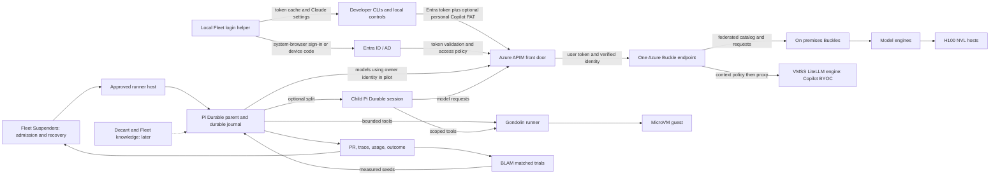

# Rollout plan — Azure Buckle, Fleet workers, and on premises models

Implementation status: the architecture is agreed; dispatch begins with
the current-chain characterization in
[`implementation-contract.md`](implementation-contract.md). That contract
defines repository ownership, bounded lane briefs, unresolved credential
bindings, and the boundary guard required before multiple feature lanes.
This roadmap does not authorize one lane to build all of P0–P5.
`docs/target-architecture.md` is superseded design history.

## Anchored owner directives (2026-11-16 — binding until superseded here)

1. **Workers self-pick their model via `.prefer` semantics.** No single
   hard-pinned lane model. A startup file (hardcoded for now) typically
   lists `hub=` and `prefer=`. Parsing follows the fleet `.prefer`
   vocabulary: `must=` / `prefer=` / `can=` accept comma-separated models
   tried **in order of listing**; `hub=` / `hub-url=` accept
   comma-separated buckle endpoints, first working wins. The worker
   probes buckle's catalog, takes the first model that round-trips a
   representative ask, and works there.
   - `prefer=a,b` — ordered soft list; if NONE are available/working,
     fall back to a baked-in list of DEFAULTS and try those in order.
   - `must=a,b` — ordered hard list; if none work, the worker **errors
     out** (refuses to run on a wrong model).
   - `tag=` / `color=` — identification keys (label the worker in logs/
     dashboards); no routing effect.
2. **Worker auth topology**: the worker requests whatever auth it needs
   from buckle and rides buckle → litellm (engine-held credentials). A
   baked-in fallback endpoint is acceptable if needed.
3. **The PAT is engine-only.** Buckle never mounts user tokens; it gets
   `engine.url` + an engine key. (Already law; restated as an anchor.)
4. **Keep litellm updated to latest** on the engine leg. Known class:
   claude-via-copilot 422s are usually thinking/param translation — the
   litellm copilot lane handles it.
5. **Later, not now**: launching workers from GUI / CLI / MCP-skill, and a
   sqlite ledger (in buckle or suspenders on the VMSS) remembering what
   runs where. Hardcoded startup file until then.
6. **No max_tokens or limits on worker asks (for now)** — proven root
   cause 2026-11-16: the copilot seat 422s when input + default
   completion allowance exceeds the SKU's budget (max_tokens=256 → 200,
   1024+ → 422 on the same ask). Resolution is model PICKING, not
   capping: the .prefer probe uses the heaviest ask shape and skips any
   model that cannot serve it unlimited. `.prefer` may still carry
   operational knobs — `max_tokens`, `max_loops`, and similar — where
   ABSENCE or 0 means no limits (the default stays unlimited).
7. **8-lane durable crash-recovery demo (goal state)**: azure buckle
   spins up 8 pi-durable worker lanes, well-primed for the tasks we need;
   landed work gets thorough review against our patterns; push the new
   image to ACR as the crash event — everything dies — and the durable
   workers retake their work from the journal and continue. This is the
   P1.5→P3 arc's acceptance demo.
8. **Prime the 8 workers from the pi-durable template examples to work
   on fleet itself** (fleet-buckle + fleet-worker once extracted): needs
   one new example.md variant for working on the fleet repos — the
   repoagent example pattern pointed at our own repos.

Architecture (owner ruling, 2026-11-16; Azure VMSS is the live target):

- **fleet-buckle** = the identity-aware MITM around LiteLLM. It presents
  one Azure URL, fetches provider/peer model catalogs, federates to the
  correct Buckle + LiteLLM engine, tracks the authenticated user and
  request, and injects policy-bearing context where configured. It must
  preserve LiteLLM's supported API and provider capabilities rather than
  duplicate LiteLLM routing, model lists, limits, or per-user controls.
  Model choice and provider deployment configuration belong to LiteLLM.
- **Human identity and Copilot:** APIM validates the user's Entra ID/AD
  token and endpoint access. The user token and verified stable identity
  continue to Buckle; Buckle maps the user for federation, context policy,
  and observability. Prefer LiteLLM's native user/team mapping and controls
  when the deployed version and license support them; otherwise implement
  only the missing binding at Buckle. MS Copilot also needs each user's
  GitHub PAT. The client supplies it per request in a URL lane or Bearer
  header, as the client requires;
  it passes through to LiteLLM/Copilot without becoming shared server
  config. Prove isolation between users and deny direct APIM bypass.
  For the first rollout, trust the authenticated caller's supplied PAT;
  do not add an Entra-to-GitHub account binding requirement.
- **Pilot worker identity:** workers use the owner's authenticated identity
  and owner-supplied Copilot PAT for now, with distinct Fleet run IDs for
  attribution. Dedicated worker identities/tokens are a later milestone;
  do not claim service identity or independent seat entitlement yet.
- **fleet-worker** (new repo) = Pi Durable parent/child runtime, OCI image,
  versioned capability seeds, journal, and whole-cycle e2e. A parent may
  work alone or split into scoped child sessions and integrate their patches.
- **Runner** = disposable microVMs for bounded tool operations. The Pi
  supervisor, model connection, and durable journal stay outside guests.
  Inference GPUs and microVM-capable runner hosts can be separate machines.
- **Fleet Suspenders** = admission, capacity, fencing, monitoring, recovery,
  and operator outcomes. Minimal integration is needed for the runner pilot;
  richer multi-host control follows. Developer CLI sessions have a separate
  local control face and are not automatically autonomous jobs.
- **BLAM** = isolated matched trials and evidence-backed seed promotion.
  Decant/Fleet knowledge is later. Absurd is only a possible future
  cross-host delivery experiment, not an extra work ledger in this rollout.

Current evidence: the plan records `/dev/kvm` on the 2-vCPU/7-GB VMSS;
recheck usable virtualization at deployment. `fleet-buckle` already has
Docker federation and Azure/BYOC tests plus an OCI worker prototype whose
Docker microworkers perform file checks. An uncommitted engine-held-seat
generator experiment emitted 42 Copilot legs; that is **not** the chosen
personal-PAT rollout and does not prove the VMSS serves them. The current
worker is not yet a microVM-hosted Pi supervisor. Label Docker Desktop,
emulated QEMU, VMSS, and real Xeon evidence separately. This plan records
intended work, not deployment state.

Known Phase 0 gaps: `test/e2e/buckle.e2e.azure.spec.ts` demonstrates OIDC
on the GUI `/api` seam while the model wire remains separately reachable.
`deploy/worker/worker.model.ts` sends a hardcoded body model to prove an
old lane pin. Neither is the desired Entra-bound, catalog-selected flow.

---

## P0 — personal-Copilot-PAT cycle on the live Azure VMSS — FIRST

Prove the intended MITM + LiteLLM + Entra + client-supplied PAT chain
before extraction. The current engine-held-seat experiment is not the
rollout baseline. Select a model from the live catalog for each test;
do not add a Buckle model pin or a hardcoded catalog row.

- **P0.1** deploy the intended BYOC LiteLLM pass-through on the VMSS.
  Buckle fetches the live Copilot catalog with the caller's PAT, injects
  policy-bearing context where configured, then forwards the request
  through LiteLLM to Copilot. Keep LiteLLM responsible for model/provider
  capabilities; prove the relevant API faces and streaming survive both
  proxy hops. Do not promote `ENGINE_HELD_SEATS` into the pilot path.
- **P0.1a** remove the worker's hardcoded `glm-4.5` body-model and the
  lane-pin proof as rollout assumptions. The client/worker selects from
  the live authorized catalog; LiteLLM resolves the deployment and any
  model alias, balancing, or fallback. Buckle preserves that request and
  records the served result without maintaining a second model router.
- **P0.2** put APIM in front of the VMSS Buckle model API. APIM validates
  the Entra token, tenant, audience, and allowed user/group before
  forwarding the request. The validated user identity and original user
  token continue to Buckle; block direct access that bypasses APIM.
  Buckle maps the stable user for its own federation, context, and logs.
  First test whether this token can reach LiteLLM's native JWT user/team
  mapping in the deployed version and license. [LiteLLM documents JWT
  user/team mapping as Enterprise](https://docs.litellm.ai/docs/proxy/jwt_user_team_auth);
  the repo's `compose.real.yaml` uses v1.103.0,
  while the VMSS image must be inspected. If unavailable, specify and test
  a narrow Buckle-to-LiteLLM user binding, or mark those LiteLLM per-user
  controls unavailable in the pilot. Never silently map all developers
  to one engine user. Never trust a client-supplied identity header
  without the APIM boundary. This protects the **model wire**, not merely
  the GUI `/api` seam.
  A Bearer PAT and a LiteLLM JWT cannot occupy the same Authorization
  header; verify LiteLLM's actual per-user binding mechanism for this
  request shape rather than assuming JWT passthrough works.
- **P0.2a** carry two distinct credentials on Copilot calls: Entra
  user token for APIM and Buckle admission (and LiteLLM user mapping
  where supported) and that user's GitHub PAT for the Copilot upstream.
  Keep the PAT in user-side CLI/worker
  configuration; Buckle and LiteLLM relay it only for the request.
  Prove the current client and LiteLLM version can carry both without
  one overwriting the other. No shared PAT in VMSS env, engine config,
  image, or database. The pilot worker acts under the owner's identity.
  Support both `Authorization: Bearer <PAT>` and the existing
  `/w/<lane>/<PAT>/v1` path where a client requires it. On Bearer-PAT
  calls, carry the Entra token in a separate named header validated by
  APIM; APIM must remove caller-supplied identity assertions before
  stamping the verified identity for Buckle. Never interpret the PAT as
  an Entra token or let a path PAT take precedence over a different
  Bearer PAT silently. Test the actual client behavior for each carrier.
- **P0.2b** verify the BYOC catalog path: with the owner's PAT, the
  owner and pilot worker can fetch the live Copilot catalog; with no
  PAT, the cold Copilot catalog is honestly unavailable. The current
  `src/catalog/buckle.catalog.fetch.ts` implements the cold behavior.
  Test per-user authorization even if model rows are cached seat-wide.
  A second user's PAT must never be reused or exposed by catalog cache,
  logs, traces, error bodies, or the current `/w/<lane>/<token>` URL
  carrier. If the carrier cannot be made safe, change it before rollout.
- **P0.2c** prove unmodified Claude Code can use Buckle as its gateway:
  put its gateway variables in the user's Claude settings JSON. For
  Bearer-PAT mode, `ANTHROPIC_BASE_URL` points at the APIM Buckle
  `/w/<lane>` root, `ANTHROPIC_AUTH_TOKEN` carries the personal PAT,
  and `ANTHROPIC_CUSTOM_HEADERS` carries the separate Entra token.
  For URL-PAT mode, the base URL ends in `/w/<lane>/<PAT>` and
  `ANTHROPIC_AUTH_TOKEN` carries the Entra token in the normal
  Authorization header. Both are client settings, never repo settings.
  Exercise `/v1/messages` with tools, SSE, and a full tool round trip;
  forward Anthropic version/beta headers and streamed events in order
  without buffering. Enable gateway model discovery and verify
  `/v1/models` contains only the authenticated user's entitled rows.
  For the owner pilot, explicit script rerun on Entra expiry is enough;
  test automatic refresh before broad adoption. If the starting model ID is absent,
  select an entitled discovered model in the client or configure a
  LiteLLM alias; do not pin the lane or hardcode a Buckle model row.
  A local Fleet harness/skill/MCP may later acquire and refresh Entra
  tokens and set CLI configuration. A static settings token expires;
  prove a renewal path before broad adoption (for example a tested
  credential helper for URL-PAT mode). The Azure wire contract must
  work without a custom Claude Code binary. [Claude Code's
  gateway configuration](https://code.claude.com/docs/en/llm-gateway-connect)
  documents these variables. LiteLLM owns the Anthropic Messages to
  provider/model translation, including GLM and other model families;
  Buckle preserves that engine capability through federation and context
  injection. The live CLI test verifies our deployed chain, credentials,
  tools, and streaming. Anthropic's vendor support policy is not an
  architecture gate for this rollout.
- **P0.2d pilot shortcut (owner approved)** use a small standalone
  Node/Bun script under `test/manual/entra-login/` while the final auth
  tooling is decided. Give it a registered public-client app ID, tenant,
  API scope, gateway URL and a local PAT file path through runtime config.
  Use MSAL's browser authorization-code flow to obtain an API access
  token after tenant-required MFA; do not use a Graph token or ID token.
  Write a private temporary Claude settings file, preflight APIM, then
  launch the CLI. Support the URL-PAT and Bearer-PAT configurations above.
  On expiry, exit clearly and rerun the script; automatic renewal, a
  permanent token cache, skill/MCP packaging and a new client repository
  are not pilot prerequisites. Keep its dependencies in its own package;
  no Buckle runtime dependency or production auth subsystem is added.
  The script does not replace APIM validation or the per-request identity
  contract. Record the live owner pilot separately from org readiness.
- **P0.2e org readiness** ship a mechanical local login/bootstrap command before
  declaring Claude CLI ready. It checks the Entra token cache silently,
  opens the system browser for interactive sign-in when required, and
  offers device code as a fallback. It requests the APIM API audience,
  stores the token in an OS-protected user cache, and preflights a safe
  authenticated Buckle catalog request before launching Claude Code.
  On APIM 401 during use, reacquire once and recheck access;
  never ask an LLM to repair login. A 403 or valid-token group denial
  remains an access error; do not loop through browser sign-in. In
  URL-PAT mode, test Claude Code's
  `apiKeyHelper` as the renewable Entra credential (it emits the token
  only and sends it in both Authorization and `x-api-key`; Buckle must
  ignore that `x-api-key` as a Copilot PAT). In Bearer-PAT mode, prove a
  separate dynamic Entra-header injector or require an explicit session
  restart; a static JSON header is not a renewal strategy. Use a small
  local CLI first; a skill or MCP can call it later. [MSAL cache and
  interactive guidance](https://learn.microsoft.com/en-us/entra/msal/msal-acquire-cache-tokens)
  and [Claude Code's credential helper](https://code.claude.com/docs/en/llm-gateway-connect)
  are the implementation references.
- **P0.3** run the current Pi Durable worker under the owner's verified
  identity and owner-supplied PAT for this pilot. Keep a separate Fleet
  run ID, but do not imply a separate Copilot seat or worker identity.
  From the live catalog choose an available model, prove direct LiteLLM
  chat and Buckle chat/stream with the actual served model, then run the
  full repoagent cycle on issue #6 if still suitable (real diff, PR,
  branch preview). Restart mid-cycle and record recovery and failures.

**AC**: APIM validates the owner and passes the verified identity and
original Entra token to Buckle. Native LiteLLM user mapping is proven
where available; otherwise record the pilot limitation and block broad
multi-user rollout until per-user binding is tested. Both URL-PAT and
Bearer-PAT paths preserve the same user attribution;
the owner's client-provided PAT reaches Copilot through Buckle and LiteLLM
without a server-held shared PAT. Catalog, chat, stream, context injection,
usage attribution, and denial without a valid user/PAT are observed live.
Test missing, expired, and wrong-user Entra tokens; missing and invalid
PATs; conflicting URL and Bearer PATs; and two users with isolated
catalogs, logs, and usage. Redact URL credentials from APIM, Buckle,
LiteLLM, reverse-proxy, and trace records.
Cold-start login must open the browser before any model call. The owner
pilot may recover an expired token by rerunning the temporary script;
automatic renewal is an org-readiness gate. A denied principal receives
a clear error without a sign-in loop.
The worker cycle produces a real PR and resumes the same submission after
restart. Record commands, source SHA, image digests, VMSS instance,
selected and served model, result links, and timestamps. Docker Desktop
tests pass on the same source with two distinct users and isolated PATs.

**Checkpoint**: this exact system is what fleet-worker extracts.

## P1 — fleet-worker repo (extraction; product = code + images + e2e)

- **P1.1** skeleton mirroring fleet-buckle's laws (AGENTS.md adapted:
  TYPE LAW, NO-TRY-CATCH, 400-line/60-fn/25-stmt, qlty blocking, knip,
  no-slop tests, edit law, exactOptionalPropertyTypes, TS4111; package
  scripts; tsconfig.base; .githooks/pre-commit; dotfiles; knip.jsonc).
- **P1.2** move: `deploy/worker/worker.*.ts` (11 files, 866 lines) →
  `src/` (names preserved, minimal churn); the 38 pi-durable `examples/`
  → `examples/` (durable-API reference, ships with the product);
  `deploy/worker/Dockerfile` → root `Dockerfile`; `test/kit/stub` →
  `test/kit/stub`; `test/e2e/buckle.e2e.agent.spec.ts` →
  `test/e2e/worker.cycle.spec.ts` composing the PUBLISHED fleet-buckle
  image (registry-pin env, version matrix).
- **P1.3** pin the Pi Durable runtime to the exact version currently
  used by the worker (`1.5.0`) and carry its copied examples as a
  versioned reference. Prove the image build works under the intended
  offline-LAN dependency policy; document the pin in AGENTS.md.
- **P1.3a** inventory the complete extraction closure, including
  `src/agents/`, any seed build, supervisor docs, root runtime dependencies
  and exports. Give each file one home: move worker responsibilities to
  fleet-worker, keep only gateway contracts in Buckle, or remove proven
  unused code in a separate bounded cleanup. The historical lift table
  does not authorize copying more monorepo code. Confirm inventory and
  actual installed versions; file counts in this roadmap are not proof.
- **P1.4** gates port: tools/src/{check-laws,laws.scan,laws.shapes},
  playwright config, unit tests, CI = tsc + unit + e2e + qlty + knip.
- **P1.5** publish/pin the immutable Buckle image needed by the new
  standalone worker e2e before cutting the test over. Replace the VMSS
  worker with a pinned `fleet-worker` image, prove journal compatibility
  and the real cycle, and retain a rollback image. Only then remove
  `deploy/worker/` and its tsc target from Buckle; keep a pointer doc
  and cross-repo version matrix. Both repos' gates must remain green.

**AC**: fleet-worker standalone green (tsc, unit, e2e cycle vs published
buckle image, laws, knip); fleet-buckle green without worker code; both
landing commits cross-reference shas; image builds:
`docker build -t ghcr.io/klh/fleet-worker:<sha> .`

**Checkpoint**: `fleet-worker` builds an image that passes its own e2e.

## P2 — real microVM tool execution on the existing VMSS

- **P2.1** pin Gondolin and its selected backend. Verify usable KVM on
  the VMSS rather than assuming `/dev/kvm` alone proves it. If that
  backend cannot boot there, record the result and select a supported
  QEMU/libkrun mode explicitly. Firecracker is a later Linux/KVM option.
- **P2.2** keep the Pi Durable parent and journal in the OCI worker on
  the host. Add a Gondolin executor for bounded tool guests, with
  workspace leases, resource limits, default-denied network, and scoped
  credentials. A tool-guest proof is not whole-worker microVM packaging.
- **P2.3** add a `WORKER_EXECUTOR=docker|gondolin` axis to the same
  whole-cycle test. The Gondolin adapter uses `VM.exec` and HTTP hooks;
  allow only the operation's named external/internal hosts and inject
  each credential for its matching host. The current `checkFile` seam
  runs syntax checks only; passing it does not prove GitHub/model calls
  execute inside the VM. Retain Docker as baseline and rollback.
- **P2.4** package the runner so Docker Desktop can exercise it locally,
  but require a separate live VMSS boot, tool, loss, and cleanup receipt.

**AC**: a real VMSS microVM executes a tool step during the full worker
cycle. Kill the guest and prove the same Pi session reports the failure,
fences the old guest, replaces it, and resumes safely. Docker Desktop
passes the same contract where supported; label its backend separately.

## P3 — federate the Azure endpoint with on premises H100 service

- **P3.1** inventory actual H100 hosts, operating systems, model
  servers, network paths, capacity, and separate microVM-capable hosts.
  Do not assume an inference GPU host can run the selected VM backend.
- **P3.2** deploy one on premises Buckle plus model engine, then
  configure it as a downstream peer of the Azure Buckle with explicit
  grants. Buckle uses live catalog provenance to choose the peer;
  LiteLLM at that peer owns model deployments, aliases, balancing, and
  fallback. Do not copy provider model lists into Buckle settings.
  Retain the VMSS Copilot route during commissioning.
- **P3.3** from a real developer CLI, prove one Azure URL lists an
  entitled H100 model, serves a chat and stream, and returns the actual
  served-by chain and usage. Test a denied principal, 429, and peer loss.
  Give on premises Pi sessions scoped access to the same model path.
  Verify that a Copilot PAT is never forwarded to the H100 peer or another
  provider when the CLI switches models in the same session.
- **P3.4** prove the actual Entra/network edge and human-to-principal
  mapping before broad developer access. Record human, CLI session,
  autonomous job, and model usage distinctly; no raw personal seat
  token belongs in a tool guest.
- **P3.5** maintain a compatibility matrix for the deployed LiteLLM
  version: chat, streaming, tools, responses and other endpoint families
  actually offered by each model engine. Buckle forwards supported
  calls and policy-bearing context without narrowing LiteLLM's feature
  surface; unsupported provider features fail honestly at the engine.

**AC**: a developer reaches an H100-served model through Azure Buckle;
a Pi job reaches its entitled route; both expose actual model/host usage.
Denied access and a lost peer fail visibly. Docker federation tests remain
green, but the on premises route must have its own live receipt.

## P4 — Fleet-controlled jobs and measured splitting

Fleet Suspenders admits jobs, applies capacity and fencing, launches a
versioned Pi Durable parent, and reports its journal, tool guests, model
usage, patches, reviews, and recovery. The parent chooses solo work or
children. Children receive separate Fleet run identities, budgets,
worktrees, and nonoverlapping write scopes; the parent integrates and
checks their patches. In the pilot, their Copilot requests still ride
the owner's user identity and PAT. Dedicated worker identities and
Copilot entitlements require a later explicit migration and access test.
A no-split choice is a valid recorded outcome.

**AC**: run two simultaneous jobs and one parent/children job on the real
hosts. Independently kill a guest and a parent; prove journal resume,
stale-lease refusal, no duplicate unsafe GitHub effects, Fleet run-key
revocation (without revoking the owner's PAT),
and an operator recovery path. Normal developer chats remain separate
from autonomous Fleet claims despite sharing Buckle transport.

## P5 — BLAM optimization; Decant and Fleet knowledge later

BLAM runs isolated matched trials during spare capacity. Hold task,
revision, model entitlement, aggregate budget, private judge, and merge
gate fixed while comparing solo work, concurrent tools, and parent/child
shapes. Measure accepted patches, wall time, tokens, contention,
recovery, and duplicate effects. Promote a versioned seed only with a
reproducible receipt and rollback digest. Benchmark runs must not write
to production developer repos.

Once job identity, provenance, and access boundaries are stable, add
Decant/Fleet knowledge as scoped context. Record the knowledge version
used by each run. Absurd may then be compared as a Postgres-backed
cross-host delivery queue, but it must replace a named delivery duty
rather than create a second unreconciled Fleet work ledger.

---

Dependency order: **P0 → P1 → P2 → P3 → P4 → P5**. Inventory and
federation preparation may run alongside extraction, but every Azure or
on premises claim needs its own live exit receipt. The immediate work is
P0 on the running Azure VMSS.

Every receipt pins source commit, Buckle/worker/engine image digests,
seed digest, model route, runner backend, host, and timestamp. Keep the
last known-good deployment for rollback. Use the existing Fleet work
graph and live coordination to assign implementation ownership; a DONE
item or this plan alone does not prove a service is deployed.
